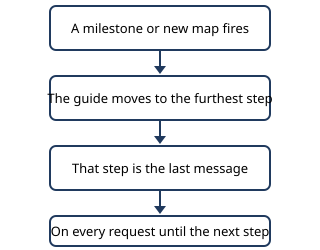
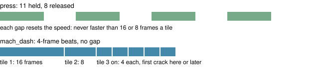

# Rayquaza lane guide

> Markdown twin of [rq-milestone-guide-v1.html](../rq-milestone-guide-v1.html), generated from the HTML by `just explainer-twins`. The HTML is the source; edit it, not this file.

Two switches for the Rayquaza lane, also called the Ray Ray lane. They give a model maximum assistance by handing it the next fact at the moment it needs it.

## Why this exists

When Qwen3.8-27B ran out of thinking tokens, it usually did not know what to do next. One sentence added as the last message took six stuck turns from 15 of 18 capped to 2 of 18. Weight edits, steering and effort settings did not. See `docs/curriculum/lesson-just-in-time-knowledge.md`.

## How the guide reaches the model

| Switch | When on | When off |
|---|---|---|
| `rq-milestone-guide-v1` | The current step, sourced and fact-checked, ends each request. | No guide note. |
| `rq-battle-explainer-v1` | While a battle is active, one short preparation note follows it. | No battle note. |

## What to know

- Steps come from `docs/curriculum/rayquaza-guide-*.md`; `scripts/curriculum/generate-guide.py` writes them into `rayquaza-guide-data.ts`.
- Both switches are off by default and in both benchmark arms.
- Runs using them show on the frontier as heavily assisted and are never pooled with arm cohorts.
- Each step is recorded as a `milestone_hint` event. The timeline is unchanged.

## Abra notes

The guide never tells the model to look for an Abra. Two short notes come from live game state, after the guide note.

- **Wild Abra:** during a wild battle against an Abra, with no Abra, Kadabra or Alakazam in the party, it says to throw a Ball at once, because Abra usually flees on its first turn.
- **Teleport:** when a healthy party Pokémon knows Teleport, the player is outdoors, the step is a trip to one town and that town holds the respawn point, it says to Teleport there instead of walking.

## Catches stay on the path

The guide never sends the model looking for a Pokémon. Route 116 says to throw a Ball at Taillow or Abra if met and never to search. A wild Taillow or Wingull also brings a battle note when the party has no Pokémon that can learn Fly, wherever it appears.

## No grind note

`rq-no-grind-note-v1` is on in the lane. After a loss the battle note says to teach a TM, change moves or buy Potions, and never to grind or hunt. Off, it also suggests catching a second type or gaining levels.

## Checkpoint recovery

`rq-checkpoint-recovery-v1` is on in the lane. Rows that mark checkpoints on one map, such as each warp in a gym, can be skipped: a later checkpoint on the same map moves the guide forward. A story step or a gate row, one holding a required action like Mossdeep's Green switch, is never skipped, and the guide never moves back. Off, a skipped checkpoint holds the guide until the next story milestone.

## Mach dash

`rq-mach-dash-v1` is on in the lane. The second Sky Pillar climb crosses cracked floor, and a stop or a slow ride on a crack drops you a floor. An ordinary press holds 11 frames and releases 8, so the bike never reaches top speed. `mach_dash` takes a whole route as beats of 4 frames, such as `D1 R4 D11 L10 U4 R2 U8`, and sends it as one `/action` POST with no gap between entries. A count is beats, not tiles: the first tile takes 4 beats and the second 2, then each tile takes 1.

The tool presses nothing unless the player rides the MACH BIKE on the field. A bike that faces the wrong way would spend the first beats turning and fall where the timing slips, so the tool taps the first direction, reads the turn back, and only then sends the route. After the route it holds the queue open with B, 30 emulated frames at a time, until the same free tile reads twice, then reports where the player ended. The game shows no text for a fall (`EventScript_FallDownHole`), so the report says the plain fact: the floor left, the floor reached, the tile and off the bike. Stairs onto SKY PILLAR TOP are not a fall, though cycling ends there. Each bend has a 4-frame window, so a route given in the guide must be sent exactly as written. Off, there is no tool and no prompt section; press and navigate_to are unchanged.

Live proof on a real game server, through the real tool and a play run with a scripted model: 1F 36 beats, 2F 40, 3F 39, 4F 32 (the planned drop to 3F at (7,4)), 5F 46, then on foot at the top, where the game ends cycling. A wrong start facing cost nothing on 1F, 2F, 4F or 5F. After a fall, the walk back and a second ride crossed the same crack. The guide gives these routes floor by floor; a `release_frames` of 0 needed the event schema to allow it, so a viewer older than this build cannot read such a run.

## Old rival line

`rq-old-rival-line-v1` exists for the Route 110 rival trials. On, the Route 110 step gives run aeb8's tactics: Rock on Wingull and Slugma, no boosts on Grovyle. Off, it gives the current tactics: X Attack and X Speed against Slugma. Everything else in the step stays the same.

## Boot options and slim prompt

The lane starts from a clean boot. The guide opens with the title screen and OPTION. It moves to NEW GAME only after the options menu closes with Text Speed FAST, Battle Scene OFF and Battle Style SET. If the model starts a game first, a note tells it to set them from the START menu.

`rq-slim-prompt-v1` runs with JIT v2 in this lane only. The standing prompt loses the PokéNav, learn_move, choose_evolution and Surf sections. Each one is sent whole, just before the guide line, only while its trigger holds. The guide line is always last.
