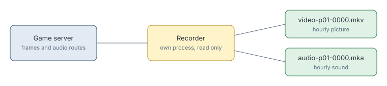

# Run recorder

> Markdown twin of [run-recorder.html](../run-recorder.html), generated from the HTML by `just explainer-twins`. The HTML is the source; edit it, not this file.

`pokebench_env.recorder` saves a run's moving picture and sound to files, with no screen involved. Start it with `launch.sh --record`.

## Why it exists

A run keeps one picture per turn, about 38 seconds apart. The full-rate picture and the sound go only to live watchers, so nothing else can make a video of a run afterwards.

## How it works

*Picture and sound are timed by game frame, not the wall clock, so a pause in the run costs neither anything.*

## If something fails

The recorder only reads, so its failure cannot reach the run. An encoder that dies is restarted into a new part, and every failure goes to `recording.jsonl`.

## Joining picture and sound

`ffmpeg -i video-p01-0000.mkv -i audio-p01-0000.mka -c copy joined.mkv`
