PokeBench · viewer tooling explainer

# Runs survive viewer restarts

> Markdown twin of [run-survives-viewer.html](../run-survives-viewer.html), generated from the HTML by `just explainer-twins`. The HTML is the source; edit it, not this file.

The 8790 viewer serves the run page and the stats page. Fixed-run tooling owns measured trial launches; the experiment queue and finals scheduler were retired on 2026-10-22. Before this change, restarting it to ship a viewer or stats update could kill the trial in progress, or leave the next viewer stuck. Now a restart leaves the trial playing, and the new viewer picks it up where the old one left off.

**Historical diagrams:** the process-isolation design below retains former queue/finals labels and launch descriptions for context. These are not current launch instructions; measured launches use fixed-run tooling.

## 1. Who owns the trial's processes

*Every launch (experiment trials, finals, NEXT RUN, human restarts) now goes through one detached launcher. The viewer still waits for the trial's exit while it lives; it just no longer shares a signal group with it.*

## 2. What a restarted viewer does with a trial in flight

*Adoption works the same for queue trials and finals runs. A trial that finished while no viewer was up is recorded from its run_end instead of being rerun. The budget check only gates new launches, so an adopted trial is always recorded.*

## 3. When a leftover lease can be taken back

| Lease owner (viewer) pid | Run it names | Play pid it names | Result |
|---|---|---|---|
| alive | any | any | held: another viewer or cohort is using it |
| owner file missing or unreadable | n/a | n/a | held: it may have been taken a moment ago |
| dead | another run | alive | held: that run still plays (NEXT RUN waits) |
| dead | the trial being adopted | alive | taken back, to adopt it |
| dead | any | dead or none named | taken back |

*The holder now writes the run id at launch and the play pid once it starts, for queue trials and finals as well as NEXT RUN. Only one process at a time may take a lease back (a `.reclaim` lock, cleared after 60 s if its holder died), so two never both hold it.*

## 4. Proof with real processes

This used this branch's runner, plus a stand-in for `live.js play` that writes run_start, keeps a game-server grandchild answering /health for 20 s, then writes run_end. Each case stopped the first runner during trial 1 and then started a fresh one. Receipts are in `runs/run-survives-viewer/`.

| Case | Trial 1's play and game server | Fresh runner |
|---|---|---|
| Before, Ctrl-C (SIGINT to the viewer's group) | both died | stuck: "the gameplay lease is held" |
| Before, deploy (SIGTERM to the viewer pid) | both kept playing | refused: "live run … is still running"; it would rerun the trial once it ended |
| After, Ctrl-C | both kept playing | adopted trial 1 (launched once, one outcome), then ran trials 2 and 3 |
| After, deploy | both kept playing | adopted trial 1 (launched once, one outcome), then ran trials 2 and 3 |
| After, `viewer-restart.sh` on an owned port (18990) | the stand-in run kept playing | new viewer up, stats page HTTP 200, run listed live; script exit 0 |

*None of these touched 8790 or the finals. viewer-restart.sh also counted the real finals agent among the live gameplay processes and confirmed it was still running afterwards.*

## 5. Deploying

`just viewer-main` builds the viewer worktree, then calls `scripts/viewer-restart.sh`. That script records every live `agent/dist/live.js play|human` pid, sends SIGTERM only to the process listening on the port, starts the new viewer, and fails unless every recorded pid is still alive. On SIGTERM or SIGINT the viewer closes its server and stops its queue runner, and never signals a run.

**The first restart onto this build** stops a viewer that still runs the old code. A pid-only SIGTERM (what viewer-main sends) leaves that viewer's trial playing (row 2 above), and the new viewer adopts it.

## 6. Status

Viewer tests (662), the 90% coverage gate, tsc and eslint all pass. Claude found three blocking problems across two reviews; all are fixed and tested. A final Claude + Grok review is pending. Not merged, and 8790 is not restarted: merging to main while the finals run stalls them at the next run boundary, so that waits for the operator.

Known limits: pid liveness uses signal 0, so a reused pid of a dead play process could make adoption wait until its game server stops answering. A lease written before this change names no run, so it relies on the live-run check alone.
