PokeBench · Safe navigation strides · Bundle ON · Control OFF · General default OFF

# Plan the corridor. Validate each step. Stop at its end.

> Markdown twin of [safe-navigation-strides-v1.html](../safe-navigation-strides-v1.html), generated from the HTML by `just explainer-twins`. The HTML is the source; edit it, not this file.

A\* still routes to the coordinate the model chooses. This switch changes how that route executes: it splits straight plain-floor sections into explicit corridors of at most **eight tiles**, then checks native movement before every step.

## OFF: a timed press can overrun

## ON: movement owns the timing

## What qualifies for a stride?

The next A\* steps must share one direction. Every tile must be known plain floor with the same ordinary elevation. The corridor stops before grass, a ledge, wall, object, warp, script coordinate, elevation change or the requested endpoint. It never chooses a new destination.

1. Record the exact origin, map identity, elevation and one-to-eight planned coordinates.
2. At the native frame boundary, check the current map, stationary player, available controls and next live tile.
3. Submit the direction, adding B only when automatic running is enabled and the game currently permits it.
4. Release all direction input while the avatar moves. Confirm the expected next coordinate at rest.
5. Repeat inside the approved corridor, or stop immediately if validation fails. Finish stationary at its endpoint, then replan.

Special terrain retains the existing planner rules and uses an ordinary walking step with automatic running disabled. A corridor has a fixed **224-frame ceiling**. No inputs continue beyond an invalid corridor. Warps, conversations and battles remain interruption boundaries.

## What gets recorded?

| Evidence | Meaning |
|---|---|
| `button_press.stride` | Unique stride ID, requested map, origin, exact path and elevation, recorded before submission. |
| `native_action` | Buttons actually submitted on native frames, including releases. |
| Navigation stride receipt in the tool result | Matching ID/path, completed tiles, native frame count and terminal reason; delivered to the model and retained in replay. |
| State and raw RAM | Coherent endpoint with the corresponding frame and integrity-checked native archive. |

## Why zero-travel calls still happen

The previous 50-run audit had **1,021 zero-travel calls**. Of these, **901** were refusals or blocked/no-path requests, **61** involved interface/control interruptions, **25** requested another map, **11** involved battle, **11** changed maps, **6** were already at the goal, and **6** were tool errors. Same-map travel deliberately does not count a map transition. This repair preserves those guards. Targeting an NPC’s occupied tile is a separate destination/interface problem.

## Performance target and current status

**Target: median sampled travel at least four tiles per navigation call**, twice the historical two-tile median. Zero calls stay in that denominator. This target needs a common-build, common-start model comparison; deterministic native probes cannot establish policy benefit.

In an owned Petalburg checkpoint probe, the incumbent moved two tiles and stopped; the candidate completed the requested eight-tile corridor at the exact endpoint. This is engineering correctness evidence, not a measured model improvement.

Candidate branch: a working branch. General defaults remain OFF; the operator enabled this switch in the canonical bundle treatment on 2026-10-19, with control OFF. Native proof and focused tests are recorded; the worklog records full gates, cloud review and landing separately. No experiment is queued or approved.

Source grounding and limits

Reference game source: pret/pokeemerald revision `731ad5bfd6e6f265508d0efcca0ba42f9dcf5881`. Player movement is owned by `field_player_avatar.c`; object movement/held-action flags by `global.fieldmap.h` and `event_object_movement.c`. Existing PokeBench native permission and live-map readers supply verified ROM offsets. Running is eight movement frames per tile. The pinned vendor’s configured ten-frame hold produces eleven held frames; this switch leaves vendor code pristine and stops its private queue marker through the existing adapter state.

Only ordinary plain-floor corridors qualify. The model still chooses goals, and geometric planning still cannot guarantee no future battle, NPC movement or script interruption. Local navigation still uses nearby geometry; visited terrain and full-map modes retain their own information boundaries.

