Harness switch · guard · `same-plan-breaker-v1` · needs deterministic-loop-guard-v1 · off by default

# Same-plan breaker

> Markdown twin of [same-plan-breaker-v1.html](../same-plan-breaker-v1.html), generated from the HTML by `just explainer-twins`. The HTML is the source; edit it, not this file.

In both 30-turn stalls of run sh02 (the twin at Littleroot (11,1), T142–T171, and Birch's "Don't leave me" on Route 101, T263–T307) the model wrote the same plan, nearly word for word, every turn, while the game only repeated itself. The loop guard said nothing. This switch posts a factual supervisor note when the last 3 plans are near-identical and none of those decisions moved the game on.

## What the model sees

Off, nothing. On, at the next model call after turn 264 of sh02, the loop guard's note slot carries this, replayed from the recorded events:

```
SUPERVISOR: Your last 3 plans (turns 262, 263, 264) were the same and the game state did not change: I am at (7,15). I am facing right. I need to go to Professor Birch at (4,13). I will go north to (4,14) and then face up to talk to him. I will go north to (4,14) first.
```

When the state went back and forth instead of standing still, the note names the two states (turn 144):

```
SUPERVISOR: Your last 3 plans (turns 142, 143, 144) were the same and the game state did not change beyond going back and forth between LITTLEROOT TOWN (map 0/9) at (11,2) facing up and LITTLEROOT TOWN (map 0/9) at (11,1) facing up, field controls locked: I am at (11,1) in Littleroot Town. I need to go to Route 101. The map connection says "- NORTH -> ROUTE101 (map 0/16)". I will press UP to go to Route 101.
```

The plan is quoted whole, never shortened. The note is shown once, at the next model call, the way stall briefings are; it re-arms after 3 more decisions. The run continues.

## Same plan: a fixed similarity

A plan is a reply's thinking and text. Both are lowercased and split into tokens: runs of letters and digits, and every other non-space character on its own. Similarity is 2·LCS / (|a| + |b|), the longest common token subsequence over the total length: 1 for identical plans, 0 for plans that share nothing. The 3 latest plans are "the same" when every pair is at least **0.80**.

| Pair in sh02 | Similarity |
|---|---|
| T145 "I am at (11,2). I need to go to Route 101. …" vs T146 "I am at (11,1). …" | above 0.95 |
| Twin stall, worst pair in any firing window | 0.91 |
| Route 101 stall, worst pair | 0.84 |

At 0.85 the Route 101 notes start at T264 but skip T265–T267, where the model added "I am stuck in a loop"; at 0.90 they start only at T270. The state rule below, not the threshold, is what keeps notes out of ordinary play.

## The game state did not move on



*The window of 3 decisions and the two states before it. Only the states reached in the window are named in the note.*

A state is: screen, map, position, facing, field-control lock, the story flags, the party (species, level, HP, status), the battle (phase, turn, outcome, each battler's species, HP and status), the menu's phase, selection and value, and the dialogue text. Only a started overworld state with map, position and facing, or a battle whose input is ready, counts. Intro screens, naming, transitions and unknown readouts withhold the note.

## Measured on sh02

1006 decisions (snapshot to turn 1009). 398 three-plan windows are near-identical; only 79 of them also leave the game where it was. With re-arming every 3 decisions the switch would have posted 28 notes:

| Where | Notes | Turns |
|---|---|---|
| Twin push-back, Littleroot (11,1) | 10 | 144, 147, … 171 |
| Birch's "Don't leave me", Route 101 (7,15) | 15 | 264, 267, … 306 |
| Route 103: UP into water at (23,12); navigate_to refused at (19,7) | 3 | 780, 800, 803 |

False positives: none. No note in any window where a decision reached a new state; none while walking, in the Route 101 battle, in the truck or in the intro. With the switch on, the T171 milestone-drought briefing moves to T172, because the same-plan note held the loop guard's note slot that call; every other guard event is unchanged.

## Wiring


*It uses the stall-briefing note path the loop guard already has: the note is refused while a loop episode or another note is open, in diagnostic mode and after a stop, and then tried again at the next decision. Recorded as a `loop_guard` event with kind `same_plan`; the viewer labels it "Same plan repeated".*

## Off

No subscriber, no note. Tests replay the sh02 fixture through the real loop guard with the switch off and on: off posts no same_plan note, and every other guard event matches.

## Status

- Default off; meant for the bundle arm of bundle-v-control (that file is edited elsewhere). A separate branch fixes the loop guard's own blind spot for push-back cycles; the two are complementary.
- Gates: test, lint (mypy's known `mgba._pylib` worktree error only), build, coverage ≥ 90 in both stacks.
- Not done: no measured runs. Pending experiment entry `experiments/same-plan-breaker.json`.
