# Same target, no progress

> Markdown twin of [same-target-no-progress-v1.html](../same-target-no-progress-v1.html), generated from the HTML by `just explainer-twins`. The HTML is the source; edit it, not this file.

`same-target-no-progress-v1` · guard · needs `deterministic-loop-guard-v1` · bundle-only, default off · guard approved by Operator 2026-10-20

In control run `2026-10-20T16-14-34_qwen36-gpu0_a8f9`, from turn 1282 (6:42 PM New York) the model called `navigate_to {x:29, y:16, map_id:[24,4]}` again and again in RUSTURF TUNNEL: 39 times, then 12 or more times to (18,20). From turn 1282 to 1322 each walk hit the 8-button command limit or was stopped by a wild battle, and every one ended on one of six tiles within 3 tiles of (4,9). No loop guard fired; only the 5-minute milestone-drought briefing did, at turns 1309 and 1340.

## Where the walks ended

*Every navigate_to to (29,16) from turn 1282 ended on one of (4,7) (4,8) (4,9) (5,7) (5,8) (5,9), at most 3 tiles from (4,9). A call that ends 4 or more tiles from the anchor resets that target instead of counting.*

## Why the existing guards missed it

| Guard | What it needs | a8f9 |
|---|---|---|
| `ineffective-loops-v1` | alternating targets ending on at most 2 tiles; resets on battles | one target, six tiles, a battle every few calls |
| deterministic loop guard, same target | no movement between calls | each call moved the player a tile or two |
| `ineffective-navigation-v2` | walks ending on the start tile; resets on any battle | walks ended on a different tile |
| `duplicate-turn-collapse-v1` | identical turns | turns differed (battles, positions) |

## How the count runs

*Replaying a8f9's recorded events (seq 41060–43000) with the switch on: the 4th counted call (turn 1286, result seq 41310) opens the episode and the 8th (turn 1292, seq 41605) rebriefs it. battle_action calls and battles do not reset the count. Later notes land at turns 1296, 1302, 1308 and 1318.*

## What resets and what does not

| Event | Effect |
|---|---|
| A wild battle, battle_action, presses in battle, an evolution or level-up screen, observe, navigate_to to another target | nothing: the count goes on (other targets keep their own counts) |
| A counted-shape call ending 4 or more tiles from its anchor | that target starts over; the next call anchors it again |
| A map change (the state's map), a story milestone, a changed known story flag, the target reached | every target starts over, and an open note closes (a `recovered` event) |
| Any call that leaves the player in a free field 4 or more tiles from the warned target's anchor | the open note closes and that target starts over, so a note does not outlive a walk away by presses |
| Errors, unknown or transition end states, a call ending on another map | not counted, no reset |

A call counts when it ends on the anchor's map with field controls free, in a battle (the position a battle state shows is the tile it started on) or with field controls locked. `navigate_to_target` calls count under their target's tile: a warp or interaction tile, or the object's tile in the state the call began from; a map connection has no tile and is not tracked. Reached means on the tile for navigate_to, within 1 tile for navigate_to_target.

## What the model is told

With the switch off, nothing changes. With it on, the note below is the loop episode's briefing (with `loop-guard-supervisor-v1`; without it the same text sits inside the usual `LOOP GUARD (same_target_no_progress): …` line). It is shown at every model call while the episode is open, from turn 1287 (6:42 PM New York) here. Every clause comes from the recorded state and the harness's own result lines; it gives no order, no route and no place the game has not shown.

OFF, turn 1287: (no loop guard text)

ON, turn 1287: SUPERVISOR: Since turn 1282, when you were at (4,9), 4 of your navigate_to calls to (29,16) on RUSTURF TUNNEL (map 24/4) have ended within 3 tiles of (4,9). The latest 4 ended at (5,8), (4,7), (4,8) when a battle began, and (5,9). Their results said: "Navigation: command limit: stopped at (5,8) after 8 ordinary button attempts, the most one navigate_to call makes; call navigate_to again to continue to (29,16); 8 ordinary button attempts."; "Navigation: command limit: stopped at (4,7) after 8 ordinary button attempts, the most one navigate_to call makes; call navigate_to again to continue to (29,16); 8 ordinary button attempts."; "Navigation: walk interrupted: field controls were locked; after auto-advance: the battle action menu is ready (FIGHT, BAG, POKEMON, RUN); highlighted FIGHT; 1 ordinary button attempts."; "Navigation: command limit: stopped at (5,9) after 8 ordinary button attempts, the most one navigate_to call makes; call navigate_to again to continue to (29,16); 8 ordinary button attempts.".

The loop guard keeps one episode at a time. While this note is open, no other loop note or stall briefing is sent: in the a8f9 replay the milestone-drought briefing of turn 1309 would not have gone out. While another loop note is open, this one is not sent; it is recorded as a diagnostic `would_warn` event whose message starts "Not sent (another loop episode is open):".

From the 8th counted call the note adds how many of all counted calls stopped when a battle began (turn 1292 here: "3 of the 8 stopped when a battle began."). Result lines are quoted whole, each once.

## Wiring

*The switch travels from the run's FeatureSet through `attachLoopGuard` to the coordinator, which owns the counter. Its warnings are `loop_guard` events: Activity History and the raw-event inspector show them; the viewer does not add them to the timeline's errors lane (operator decision 2026-10-16).*

## Status

- Not merged. Tests: counter unit cases, coordinator episode, the a8f9 replay above, registry and wiring, viewer Activity History without a timeline mark.
- Pending experiment `experiments/same-target-no-progress-v1.json` (not queued); joins the bundle arm of `bundle-v-control` and `bundle-cook-1h`, off in control.
- Not done: measured runs (only Operator approves and launches them).
