# Scene follow-up

> Markdown twin of [scene-followup-prompt-v1.html](../scene-followup-prompt-v1.html), generated from the HTML by `just explainer-twins`. The HTML is the source; edit it, not this file.

`scene-followup-prompt-v1` · guidance · default OFF · ON in the bundle, OFF in control · needs `script-line-presence-v1`

## What it does

When a scene plays out on its own, the next request gets one SUPERVISOR message. It quotes the scene's pages whole, lists who was on screen (at the tiles where they stood during the scene), and marks that as a story event rather than background flavor. Facts only: it does not tell the model to talk to anyone or prescribe a next action, because those actors often leave before control returns. The note joins each request until the model has answered one that carried it, so other results in the same turn can't drop it, and the model reads it once. The message is built from the game's own pages and object list, whole and in order, never truncated. It names nothing the game did not show, and it says nothing about what the scene leads to.

**Off:** no message; every request is unchanged. The system prompt is the same in both arms.

## When it fires

*All five are game state from the recorded dialogue pages. Across 494 recorded runs, the rule fires only on the Rustboro theft scene (11 of 11 runs that saw it). It stays silent on 63 other story scenes, where someone had already spoken to the player.*

## Recorded example (9e33, turn 1384)

> SUPERVISOR: You just watched a scene play out on its own while you could not move. The game showed: "Get out! Out of the way!" "Wait! Pleeeaaase!" "Don't take my GOODS!" The people in it were: MAN_3 at 26,23; MAN_4 at 19,27; MAN_2 at 20,21 (where they stood during the scene). That was a story event, not background flavor.

## Evidence (decision probes on 9e33's model and quant)

| Measure | off | prior talk-order note |
|---|---|---|
| DEV, 3 theft contexts, 32 each | 2/96 | 90/96 |
| Fresh held-out, 5 unseen runs, 32 each | 5/160 | 141/160 |
| Note forced onto a no-scene city turn | 1/32 | 2/32 |

Those probes graded the next action against a talk-to-participant ritual and used the earlier note that prescribed that ritual. Facts-only wording has not been re-probed. The full study is in the viewer's Reports section (2026-10-27 scene follow-up prompting). Measured run effect: none yet; that needs a fixed-run comparison.
