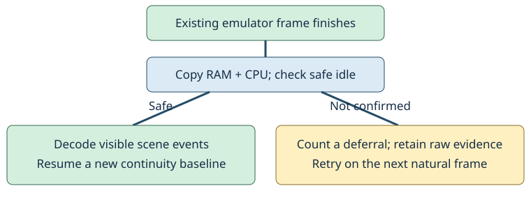

# Safe scene capture

> Markdown twin of [scene-journal-safe-capture-v1.html](../scene-journal-safe-capture-v1.html), generated from the HTML by `just explainer-twins`. The HTML is the source; edit it, not this file.

`scene-journal-safe-capture-v1` · Default OFF · Requires cutscene journal

## What changes

The scene journal already attempts to sample after every emulator frame. A frame boundary does not guarantee that the game has finished updating memory. This switch waits for a naturally occurring confirmed game idle point before decoding scene events. It never advances extra frames or changes button timing to obtain one.

Deferred samples are reported separately from actual reader errors. Intermediate events during those samples remain unproven. A scene-history warning is not a failure of the separate transcript archive or current observation.

## One frame, one decision



On a narrow screen, scroll the diagram sideways.

## Bounded evidence, honest coverage

- Ordinary scene changes and displayed dialogue continue through the existing 512-event journal.
- A raw incident window retains at most eight complete writable-memory/CPU snapshots. Two earlier samples and two recovery samples are included where the bound permits. Every evicted sample is counted.
- Ordinary later frames do not overwrite a recovered incident. A newer incident replaces it in memory.
- The scene-history HTTP reader exports immutable snapshots after releasing the journal lock, outside the emulator memory lock. It keeps at most two exported windows; an in-flight temporary window can briefly coexist. Before admitting a new window, it removes older evidence while preserving the currently published window. Failed cleanup refuses the new export, including cleanup of temporary pointer files and staging directories. Failed pointer publication removes the new window; the previous published pointer stays valid.
- These diagnostics use the existing raw-RAM format and hashes. They are separate from the mandatory per-observation raw archives, which are never pruned by this feature.
- Export failures are explicit and retried. Retention limits do not establish that every intermediate game event was captured.

Visual cadence stays unchanged: supported scenes get a sample every 120 emulated frames, with at most six images delivered per call. There is no continuous video.

## Measured cost on this Mac

Three native checkpoints (battle, field, clock), three order-balanced repeats, 600 measured frames per arm after 30 warmup frames. Same external ROM, fixed cartridge clock, no inputs, network, or model inference. All variants ended with identical writable-memory hashes.

| Checkpoint | Legacy median hook | Safe capture median hook | PNG every frame experiment |
|---|---|---|---|
| Battle | 9.0 μs | 33.8 μs | 551.0 μs |
| Field | 45.8 μs | 70.2 μs | 386.6 μs |
| Clock | 92.6 μs | 118.7 μs | 497.2 μs |

A separate paced test used the production journal HTTP endpoint while the native core ran concurrently at 60 fps. Six 360-frame arms measured 59.93–59.99 fps for both legacy and safe capture, with identical final native-memory hashes. Frame-period p99 was 23.9 ms legacy and 23.7 ms safe capture; this is host scheduling noise, not evidence of an improvement.

Diagnostic export is not free: journal-request p95 rose from 4.2 ms to 30.7 ms; the largest safe-mode request was 32.8 ms. The emulator continued while compression and disk writes ran. The retained battle diagnostics occupied about 704 KB compressed across two windows. Memory holds at most eight incident plus two rolling pre-samples (about 5.3 MB of region payload); a concurrent export can temporarily retain another immutable window.

These are local capture measurements, not a gameplay-benefit claim or a general server latency guarantee. Higher visual sampling is not justified by these results.

## OFF and activation

OFF preserves the previous hook, endpoint payload, readout wording, inputs, frame schedule and visual cadence. It allocates no raw diagnostic buffers. The treatment defaults OFF, is independently selectable, and is not attached to an existing run by a merge.

On a gap: inspect the current observation separately; distinguish scene deferrals, real scene read failures, event retention loss, and transcript/archive failures. This page does not establish that an attached player will recover correctly; that needs its own delivery and sustained-action check.

<details>
<summary>Evidence and reproduction</summary>

Game reference: pret/pokeemerald `731ad5bfd6e6f265508d0efcca0ba42f9dcf5881`, `src/main.c`, `AgbMain` and `WaitForVBlank`. The existing verified ROM idle-point reader is reused; no new addresses or writes.

```
PYTHONPATH=env env/.venv/bin/python scripts/profile-scene-capture.py \
 --rom "$POKEBENCH_ROM" --checkpoint battle=/absolute/checkpoint.state \
 --out runs/scene-profile --frames 600 --repeats 3 --extra-visuals
```

Native checkpoint and profile receipts are retained under the scene-capture worklog's ignored evidence directory. Missing intermediate events remain explicitly missing.

</details>
