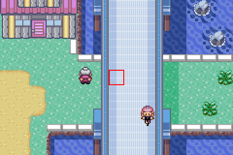

# Screen-center player

> Markdown twin of [screen-center-player-v1.html](../screen-center-player-v1.html), generated from the HTML by `just explainer-twins`. The HTML is the source; edit it, not this file.

`screen-center-player-v1` · default OFF · bundle arm ON in the current fixed definitions · control unchanged

## What went wrong

Under the Seaside Cycling Road the bridge is drawn over the player's sprite. In GLM run 0d5d the player was invisible at (16,69), and GLM took another sprite for itself (turn 1100, seq 127902; turn 1104, seq 129004: "the screenshot now clearly shows me standing ON the upper road").



*Recorded frame 129030 (3x, 1 grid cell = 1 tile). The player stands at the center of the screen but is drawn under the bridge.*

## Where the player is


*In the overworld the camera follows the player. The player's tile (orange) is the 8th of 15 columns, and its center is the center of the 240x160 image; the 16x32 sprite's head reaches into the tile above (dashed). Checked on recorded frames 126495 and 129030.*

The system prompt, in overworld scenes only, gains:

```
Finding yourself on screen: in the overworld the camera follows you, so your character is the sprite on the tile at the exact center of the screenshot (the 8th of the 15 columns across; the image's center point is the center of your tile, and your sprite's head reaches into the tile above). This holds except while a scripted scene moves the camera or a warp fades the screen. Any other character sprite on the screen is someone else. Some map tiles are drawn over your sprite when you walk under them; the readout says so when your tile or the one above it is one of them.
```

## When the map hides the sprite

The game server reads the metatile under the player and the one above. pokeemerald's `DrawMetatile` puts the top layer of NORMAL and SPLIT metatiles on BG1, which is drawn over sprites of priority 2; `sElevationToPriority` gives the player priority 2 at elevations 0 to 3 (and 5, 7, 9, 11, 15). A top layer of four blank (0) tiles draws nothing. From archive 21953 the bridge tiles at (16,69) and (16,68) both qualify, so the readout adds:

```
Your character is drawn under the map's top layer here: (16,69), your tile, and (16,68), the tile above, are drawn over your sprite at elevation 3, so the screenshot's center may not show you; the sprites you see nearby are other characters.
```

| Layer type | Top layer goes to | Covers a priority-2 sprite? |
|---|---|---|
| NORMAL (0) | BG1 | yes, if any top tile is not blank |
| COVERED (1) | BG2 | no |
| SPLIT (2) | BG1 | yes, if any top tile is not blank |

Limitation: "not blank" means a non-zero tile index. The server does not read tile pixels, so a non-zero tile that is fully transparent would still count; the line says "may not show you" for that reason.

## Wiring and OFF

Agent: `play-config.ts` adds the prompt section. Game server: `screen_center.py` reads the layers, behind the same switch through `rerender.read_state`. No tool changes. OFF: no prompt sentence and no readout line; the readout and state are byte for byte today's.

## Status

Not measured: no run has used it yet. Merging does not launch anything.
