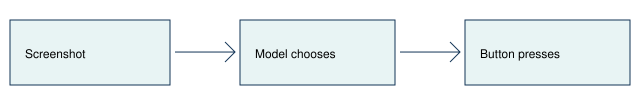

# Screenshot and button baseline

> Markdown twin of [screenshot-button-baseline-v1.html](../screenshot-button-baseline-v1.html), generated from the HTML by `just explainer-twins`. The HTML is the source; edit it, not this file.

## What the player receives

The baseline preset disables every other behavior switch. The model sees screenshots, ordinary conversation history and two tools: observe and press. A short system prompt replaces the inherited strategy and interface guidance.

Observe returns the current screenshot. Press sends the requested buttons using the existing schema and timing, then returns the new screenshot. Successful results omit text, including readout and screen notes. Private RAM and native action records remain available for scoring.

## Exact prompt

You are playing Pokémon Emerald. Make as much progress as you can. You receive screenshots and can use `observe` to view the screen or `press` to press buttons: A, B, START, SELECT, UP, DOWN, LEFT, RIGHT. Choose your actions from what you see.

## Switch off

The previous prompt and tool-result bytes are preserved. This mode requires every other behavior switch OFF. Mixed configurations are rejected. Use experiments/presets/screenshot-button-baseline.json for the baseline configuration.

## Reuse

This is a standalone opt-in preset. It is explicitly OFF in both current control and bundle arms and is not a bundle treatment. After arranging an endpoint lease through the usual run-coordination workflow, select it with `POKEBENCH_PLAY_PRESET=experiments/presets/screenshot-button-baseline.json just run-agent`. The preset starts from boot and caps the run at 30 minutes; endpoint and model selection still use the existing run environment.

## Evaluation

The initial exploratory boot run used GPU1 with a 30-minute cap. No performance or improvement claim. Replies without tools continue with the existing history and no coaching prompt. Failure and turn limits use the largest safe integer, so only the 30-minute wall cap or an explicit operator stop is expected to end play. Ordinary conversation history and exposed reasoning are recorded; no injected memory, navigation, auto-dialogue or supervisor coaching is enabled in this preset.
