Harness switch · script-line-presence-v1 · observation · default off

# Script line presence

> Markdown twin of [script-line-presence-v1.html](../script-line-presence-v1.html), generated from the HTML by `just explainer-twins`. The HTML is the source; edit it, not this file.

When a dialogue page has no speaker, the harness now says who was on screen when it was shown. It never guesses who spoke.

## The problem it answers

In live run `2026-10-16T02-23-17_qwen36-gpu1_sh02`, turn 259, the player stepped onto Route 101 and PROF. BIRCH's rescue script ran. These lines come from map scripts (pokeemerald `data/maps/Route101/scripts.inc`, `Route101_EventScript_StartBirchRescue` and the `PreventExit` scripts). The text has no `NAME:` prefix and the player faces no one, so dialogue auto-advance recorded `speaker: null` and the page list showed no speaker at all. The model never tied "my BAG" to PROF. BIRCH or to the bag object at (7,14), and walked toward Birch more than 30 times. The T307 stall briefing quoted the same pages again with no speaker.

## Before and after, the T259 result

```
Dialogue shown during this call (3 pages, in order, whole):
1. turn 259 · ROUTE101 (map 0/16) · at 11,19: "H-help me!"
2. turn 259 · ROUTE101 (map 0/16) · at 11,15: "Hello! You over there!
Please! Help!"
3. turn 259 · ROUTE101 (map 0/16) · at 11,15: "In my BAG!
There's a POKé BALL!"
```

*Off: the block the model received (tool_result seq 5853), byte for byte. The test suite reproduces it from the recorded pages.*

```
Dialogue shown during this call (3 pages, in order, whole):
1. turn 259 · ROUTE101 (map 0/16) · at 11,19 · (no speaker shown by the game; on screen: BIRCHS_BAG at 7,14): "H-help me!"
2. turn 259 · ROUTE101 (map 0/16) · at 11,15 · (no speaker shown by the game; on screen: PROF. BIRCH (sprite PROF_BIRCH) at 4,13; ZIGZAGOON_1 at 5,13; BIRCHS_BAG at 7,14): "Hello! You over there!
Please! Help!"
3. turn 259 · ROUTE101 (map 0/16) · at 11,15 · (no speaker shown by the game; on screen: PROF. BIRCH (sprite PROF_BIRCH) at 4,13; ZIGZAGOON_1 at 5,13; BIRCHS_BAG at 7,14): "In my BAG!
There's a POKé BALL!"
```

*On, with character-presence-v1 also on (as in that run): each page reads its own recorded state. Page 1 was shown before the player was walked up, when Birch was still off screen, so only the bag is listed. Exact output asserted in `script-line-presence.test.ts`.*

## What "on screen" means





*Recorded object positions. Green tiles and the red frame: the area counted as on screen, 7 columns and 5 rows each side of the player (@). Blue: listed. Red: live but not listed. B = PROF_BIRCH, Z = ZIGZAGOON_1, b = BIRCHS_BAG, Y = YOUNGSTER.*

The GBA screen is 240 by 160 pixels, 15 by 10 tiles. The player's tile is drawn at column 7 and pixel rows 72 to 88, half a tile below centre (`SetSpritePosToMapCoords`, `src/event_object_movement.c`), so rows 5 above and 5 below are partly visible. This was checked on recorded frames: sh02 frame 5853 shows Birch on the left edge at 7 columns, and run 66d3 frames 2114 and 6160 show objects 5 rows above and 5 rows below. Objects come from the state's `world_context.objects`: live, not hidden, not the player, on the current map. They are listed top row first, then left to right.

## Rules

| Case | Tag |
|---|---|
| Page has a speaker (`NAME:` prefix, faced sprite or faced object) | Unchanged; nothing extra recorded |
| No speaker, objects on screen | `(no speaker shown by the game; on screen: A at x,y; B at x,y)` |
| Story character on screen, character-presence-v1 on | `PROF. BIRCH (sprite PROF_BIRCH) at 4,13`, named only by that switch's rule: its graphics id on a map where the story places that character (`env/pokebench_env/character_presence.py`) |
| Same, character-presence-v1 off | `PROF_BIRCH at 4,13` |
| Nothing else on screen | `(no speaker shown by the game; on screen: nothing but you)` |
| State without position, map or object list | `(no speaker shown by the game; who is on screen was not read)` |
| Unknown graphics | `graphics 250 at 1,2` |

The TypeScript copy of character-presence-v1's table is checked against one golden file, `packages/agent/test-support/story-characters.json`, by both the vitest and pytest suites, so the two cannot drift. A live object's graphics id is already resolved from `VAR_OBJ_GFX_ID_n` when it spawns, and its hide flag was clear when it spawned, so the template rule applies to it as is.

## Where the tag travels



*Recorded once per page, then shown wherever that page is shown. Off, the field is never written, so every renderer prints today's bytes.*

On in the T307 stall briefing replay (loop_guard seq 7272), the recent-dialogue line becomes: `turn 261, ROUTE101 (map 0/16), (no speaker shown by the game; on screen: PROF. BIRCH (sprite PROF_BIRCH) at 4,13; ZIGZAGOON_1 at 5,13; BIRCHS_BAG at 7,14): "Wh-Where are you going?! Don't leave me like this!" | …`. Off reproduces the recorded line exactly.

## Status

- Needs `dialogue-auto-advance-v1`. Default off; not a game-server switch.
- Pending experiment `experiments/script-line-presence.json`: activation `ROUTE_101` (the first unattributed page in recorded runs is Birch's "H-help me!"), graded on `STARTER_CHOSEN`. Meant for the bundle arm of bundle-v-control, where character-presence-v1 and dialogue auto-advance are on.
- No measured runs. This page does not claim the switch helps.
