DEFAULT OFF · BUNDLE ON · NO MEASURED BENEFIT YET

# Semantic current-map feedback

> Markdown twin of [semantic-current-map-feedback-v1.html](../semantic-current-map-feedback-v1.html), generated from the HTML by `just explainer-twins`. The HTML is the source; edit it, not this file.

A stale map request gets current facts.

*navigate_to_target asks for a map other than the current map.*

## What changes

The refusal starts with the actual map name, map ID and position. The model chooses its next target.

## What passes through

Works with semantic navigation v1 or v2. The guard switch is independent. Unknown map or position is explicitly unavailable.

Example and recorded evidence

Illustrative output: Current map: ROUTE101 (map 0/16). Position: (10,7). No input was sent. The original semantic refusal and structured status follow unchanged.

Motivation: recorded run 97a0, 2026-10-20; walking batch at turn 262 and stale-map semantic refusal at turn 333. Those historical events are unchanged; examples here describe the candidate behavior.

## Off and on

OFF preserves the original refusal text and receipt exactly. ON adds facts only to the wrong-map refusal.

Wiring: run preset → registered feature → production tool factory → existing tool_result. Separate pending experiment; no queue position or approval.

Candidate implementation; review and landing are reported separately. No trials launched and no speed benefit established.
