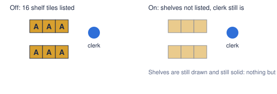
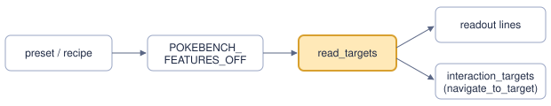

# Shop shelves off the list

> Markdown twin of [shop-shelf-hidden-v1.html](../shop-shelf-hidden-v1.html), generated from the HTML by `just explainer-twins`. The HTML is the source; edit it, not this file.

`shop-shelf-hidden-v1` stops the harness offering shop shelves as things to interact with. Registered default off; on in both arms of the current and Rayquaza recipes (Operator 2026-11-05).

## Why

A shop shelf only prints one flavor line, yet each shelf tile was listed as a candidate with a ready `navigate_to_target` argument. Run `2026-11-05T15-37-57_rayquaza-lane-qwen_0952` spent 11 turns activating them in PETALBURG CITY MART, where the readout listed 16 shelf lines.

## Before and after

*Illustrative layout, not to scale. "A" marks a tile the list offers as a target.*

## Wiring

*The one box that changes behavior is highlighted. Both outputs read the same list, so an unlisted shelf is also refused: "target is not listed in the current verified state".*

## What it hides, checked against the game

Source pokeemerald 731ad5b, and every map header of the US ROM.

| Listed thing | In the ROM | What A does | With the switch on |
|---|---|---|---|
| Shop shelf, behavior 0xE5 | 269 tiles, 18 maps | `EventScript_ShopShelf`: one flavor line | Hidden, as Operator asked |
| Sign with no script | 2 events, METEOR FALLS 1F 1R and 2R, at (9,58), outside the map | Cannot be reached | Hidden |
| Vase, trash can, bookshelves | 216 tiles in all | Their own flavor scripts | Listed: they have scripts |
| Other script tiles, signs, secret bases | Every other listed event | Their own scripts | Listed |
| Hidden items | 112 | An item | Listed |

A shop shelf does have a script. It is the one scripted thing hidden, because Operator named it. Pressing A at a shelf still shows the game's text.

## Replay of recorded Mart turns

All 71 recorded states in PETALBURG CITY MART (turns 153 to 165 of the run above) were decoded again from their raw RAM with the run's own switches, once off and once on. Read-only.

1,136 shelf targets off, 0 on (16 per state)

| Check | States passing |
|---|---|
| Off: targets match the recorded state (kind and tile) | 71 of 71 |
| On: no shelf in the readout text | 71 of 71 |
| On: MART_EMPLOYEE and the 3 other people unchanged | 71 of 71 |
| On: every other target unchanged, including the door and the questionnaire | 71 of 71 |
| On: the only readout lines removed are shelf lines, none added | 71 of 71 |
| On: all other state JSON identical, including maps and grids | 71 of 71 |

## Status

Focused tests and the replay passed. Not landed; full suites wait for a CPU window. No measured benefit is claimed. Astra presets list switches by hand, so the next Astra launch needs this key added.
