# Short-cycle fixed point

> Markdown twin of [short-cycle-fixed-point-v1.html](../short-cycle-fixed-point-v1.html), generated from the HTML by `just explainer-twins`. The HTML is the source; edit it, not this file.

`short-cycle-fixed-point-v1` · guard · acts through `duplicate-turn-collapse-v1` or `fixed-point-breaker-v1` · bundle-only, default off · approved by Operator 2026-10-21 00:08 UTC (8:08 PM New York), widened to 2–4 turn cycles by the coordinator on run 97a0

`duplicate-turn-collapse-v1` leaves out of each request a run of 3 or more identical turns: the same thinking, text and tool calls, each leaving the same game state. Two bundle runs looped without ever producing such a run:

- `2026-10-20T19-58-04_qwen36-gpu0_ef9f`, from turn 131 (8:06 PM New York): `press RIGHT,A` every turn while the clock bounced between its confirmation (NO highlighted) and its adjustment.
- `2026-10-20T20-26-22_qwen36-gpu1_97a0`, from turn 116 (8:35 PM New York): `navigate_to_target` to PROF. BIRCH'S HOUSE's door from LITTLEROOT TOWN, then to the house's door back out, turns 116–122; then from turn 120 the calls rotate in threes through turn 132 (in, the same call again, out), but that is not a cycle of the game state: the NINJA_BOY standing in the house at (9,5) when turn 120 walked in was gone when turn 123 did.

## The two loops

*Recorded calls and the state each result left. In both runs every turn repeats the turn 2 before it exactly, call and state, but the thinking differs: ef9f's six bounce turns 131–136 have six different thinking texts (the clock also moves 2 minutes each cycle); 97a0's turns 116, 118, 120 and 122 have three different ones and 117, 119 and 121 two.*

## Why the identical-turn collapse never acted

| The identical-turn collapse needs | What the runs showed | With this switch on |
|---|---|---|
| every turn to leave the *same* state | A, B, A, B in both | a turn may repeat the one 2, 3 or 4 turns before it |
| identical thinking and text | drafts that differ every turn or every other turn | only the tool calls (names and arguments) and the states must repeat |
| a state it can qualify: the field or a ready battle | ef9f: screen `clock`, so no state at all | any screen whose readout shows a ready interface with no diagnostic |
| the interface's value to match | ef9f: the clock moved 2 minutes each cycle | the clock's time is left out; everything else in the recorded state stays, including every other interface's value (a name being typed, a quantity) |

## The rule

![Each box is one turn: its tool calls and the state its result left. A run counts when every turn equals the one 2, 3 or 4 turns before it and the run holds 3 copies of the cycle, as identical turns need 3 copies. A cycle that is really shorter counts as the shorter one (A,B,A,B is 2 turns, not 4); identical turns (a 1-turn cycle) stay the identical-turn rule's. The state is the whole recorded state event minus a documented list of fields that change on their own: the event envelope and counters (v, run, type, seq, turn, t), the raw RAM reference, the observation's settle frames, play_time_s, the clock's time on the two clock-setting interfaces only (every other interface's value counts) and the berry growth timer. Everything else counts, including the whole party and battle records (PP, experience), the inventory, berry trees, objects and maps. A state with any diagnostic never joins a cycle: any key ending in diagnostic with a value or in diagnostics with entries, anywhere (party, nicknames, battle, field messages, interfaces and their details, resources). A test walks every key of real recorded states and fails if one is neither fingerprinted nor on the list.](short-cycle-fixed-point-v1/fig-2.svg)

*Each box is one turn: its tool calls and the state its result left. A run counts when every turn equals the one 2, 3 or 4 turns before it and the run holds 3 copies of the cycle, as identical turns need 3 copies. A cycle that is really shorter counts as the shorter one (A,B,A,B is 2 turns, not 4); identical turns (a 1-turn cycle) stay the identical-turn rule's. The state is the whole recorded state event minus a documented list of fields that change on their own: the event envelope and counters (`v`, `run`, `type`, `seq`, `turn`, `t`), the raw RAM reference, the observation's settle frames, `play_time_s`, the clock's time on the two clock-setting interfaces only (every other interface's value counts) and the berry growth timer. Everything else counts, including the whole party and battle records (PP, experience), the inventory, berry trees, objects and maps. A state with any diagnostic never joins a cycle: any key ending in `diagnostic` with a value or in `diagnostics` with entries, anywhere (party, nicknames, battle, field messages, interfaces and their details, resources). A test walks every key of real recorded states and fails if one is neither fingerprinted nor on the list.*

| Cycle | Stage 1 fires at | Kept | Stage 2 note (fixed-point-breaker-v1 only) |
|---|---|---|---|
| 2 turns | 6 turns | the last 2 | from 7 turns |
| 3 turns | 9 turns | the last 3 | from 10 turns |
| 4 turns | 12 turns | the last 4 | from 13 turns |

Each collapse is a `loop_breaker` stage 1 event with trigger `short_cycle`: `collapsed` counts the turns left out across every cycle in the request, and `repeats` and `period` describe the longest one. Auto-talk never acts on a cycle: it acts only on turns that left the state the same. The note, when the breaker is on (all three fixed experiments have it off):

SUPERVISOR: Make one tool call based on the game state and what you observed. Your last 7 turns repeated the same 2 turns of navigate_to_target calls, and each time round the game came back to the same sequence of screens, positions and highlighted choices.

## Before and after: where it first acts

![Recorded events replayed through the production context wiring and the decision probe (test short-cycle-fixed-point.test.ts; fixtures hold ef9f turns 125–140 and 97a0 turns 104–136). In ef9f the cycle keeps growing: by turn 140 the request keeps 125–130, 138 and 139. In 97a0 turn 123 repeated 122's call but stayed in the house, so the 2-turn cycle ended at 122 (the request for 124 keeps 104–115 and 121–123); the 3-turn rotation of calls from turn 120 is not collapsed, because the house's objects differ between its turns 120 and 123 (a NINJA_BOY left).](short-cycle-fixed-point-v1/fig-3.svg)

*Recorded events replayed through the production context wiring and the decision probe (test `short-cycle-fixed-point.test.ts`; fixtures hold ef9f turns 125–140 and 97a0 turns 104–136). In ef9f the cycle keeps growing: by turn 140 the request keeps 125–130, 138 and 139. In 97a0 turn 123 repeated 122's call but stayed in the house, so the 2-turn cycle ended at 122 (the request for 124 keeps 104–115 and 121–123); the 3-turn rotation of calls from turn 120 is not collapsed, because the house's objects differ between its turns 120 and 123 (a NINJA_BOY left).*

## Wiring

*The switch is read once, from the FeatureSet, in the breaker's constructor. With it off, the breaker computes no cycle state and the request, notes and events are exactly what they were.*

## Not covered

- One turn repeating with different thinking: 97a0 turns 131–136 made the same `navigate_to_target` call six times (131 entered the house, 132–136 stayed in it), with four different thinking texts (the identical-turn collapse acted only at turn 140, after three byte-identical turns); ef9f turns 102–126 repeated `press RIGHT,A,DOWN,A` 25 times while the clock value moved. A 1-turn cycle stays the identical-turn rule's.
- Wandering that never repeats exactly, such as 97a0 turns 106–115 among RUBY's HOUSE, the town and the lab.

## Status

A working branch (the switch was first built as `ping-pong-fixed-point-v1` and renamed before landing). Unit tests, both runs' replays through the context wiring and the decision probe, registry, experiment entry and viewer label tests pass; gates and the cloud review are recorded in `docs/worklogs/active/2026-10-21_short-cycle-fixed-point.md`. In the bundle arm of `bundle-v-control`, `bundle-cook-1h` and `whole-map-cook-1h`; pending experiment `experiments/short-cycle-fixed-point-v1.json`, not queued. No measured runs.
