# Stale plan fact

> Markdown twin of [stale-plan-fact-v1.html](../stale-plan-fact-v1.html), generated from the HTML by `just explainer-twins`. The HTML is the source; edit it, not this file.

`stale-plan-fact-v1` · guard · default OFF · proposed for the bundle arm

When a reply's thinking is word for word the previous reply's, but the game now shows a different interface or asks a different question than when that thinking was first written, the tool result ends with one line that says so. It quotes the readout and recommends nothing.

## What went wrong

Bundle run `2026-10-21T13-33-54_qwen36-gpu0_ea04` sent byte-identical thinking for 15 turns (turns 547–561, 3:21–3:23 PM ET, md5 bf66221a, seq 20494–20844). Its results cycled through four different move-learning prompts: "Delete a move to make room for DOUBLE KICK?", "Stop learning DOUBLE KICK?" and the two pages before them. The model kept answering a question the game was no longer asking. Duplicate-turn collapse did not fire: it keys on the result state, which changed every step.

## When the line is added



*The comparison is with the result the repeated thinking was first written after (here the "Delete …?" box), not with the previous result. Same Interface line and same question: nothing. Changed or empty thinking: nothing. Error results are ignored.*

## What the model sees

From the tests, on readouts taken from ea04 results seq 20504 (Delete), 20529 (Stop) and 20554 (page). OFF, the result ends with the readout. ON, the last text part of the result is one more line:

```
Your reasoning repeats turn 547 word for word; the game now shows: Interface: evolution_move_learning; input ready; A or B advances the waiting move-learning text; inspect the next choice.
```

```
Your reasoning repeats turn 547 word for word; the game now shows: Interface: evolution_move_confirmation; input ready; selected YES; UP/DOWN selects YES or NO; A chooses; B answers NO. The game asks: "Stop learning DOUBLE KICK?"
```

The Interface line and the question are copied from the same result's readout (`Interface: …` and `The game asks: "…"`). The recorded `tool_result` text carries the line, so it shows in the raw-event inspector; there is no new timeline mark.

## Wiring

`packages/agent/src/stale-plan-fact.ts`: `StalePlanFact` watches `assistant` events (thinking and turn) and non-error `tool_result` events. `withStalePlanFact` wraps the play tools outermost in `playGameTools`, so the line is the last thing the result says. Switch off: the wrapper is not installed.

## Status

- RED ee9a741d3, GREEN f330bce71. Not merged into main.
- Default OFF. ON in the bundle arm only of the fixed bundles (the operator, 2026-10-21 10:44 PM ET).
- Tests: `packages/agent/src/stale-plan-fact.test.ts` (production `playGameTools`). Multi-model review: not run yet.
- Not measured in runs. Pending experiment: `experiments/stale-plan-fact-v1.json`.
