Harness switch · observation · `stale-story-goal-v1` · needs nothing · bundle arm only · off by default

# Stale story goal

> Markdown twin of [stale-story-goal-v1.html](../stale-story-goal-v1.html), generated from the HTML by `just explainer-twins`. The HTML is the source; edit it, not this file.

A story line that names a place stays the Story goal after that place's milestone is already done. With this switch on, native completion retires that exact destination. The quote stays. The door and the walk-away note do not. Incidental later dialogue does not erase a still-active destination.

## What decides it

The latest story line that names a place is still the one that is shown. The native story checklist retires it only when the checklist label covers every place the line resolves to. A newer line that names another place replaces it through the ordinary latest-place rule. A later line with no place leaves it active.

*Native completion is required. A lab line before the Pokédex stays the goal even after unrelated dialogue. Birch's handoff is not the Pokédex.*

| Latest line resolves to | Newer fact | Switch | What the model is told |
|---|---|---|---|
| Birch's lab only | Pokédex flag false or null | on | The door, as today |
| Birch's lab only | Pokédex received | off | The door, as today |
| Birch's lab only | Pokédex received | on | Done: Pokédex received. No door |
| ROUTE 103 only | Route 103 rival battle won | on | Done: Route 103 rival battle won. No door |
| Birch's lab only | Later dialogue with no place | on | The door remains |
| Lab and another place | Pokédex received | on | Both ways in, as today |
| A newer place | Pokédex received | on | That newer place |

## The same line, off and on

These are the two strings the tests lock. The first row is the story-destinations block. The second is the harness-trust header. In the live cook, bundle run `2026-10-17T19-38-19_qwen36-gpu0_b7d1`, MAY's lab line kept that door after the Pokédex flag was already true, and the model went back to the lab.

| Off | On |
|---|---|
| `Latest story line naming a place (turn 5, MOM): "Go see MAY at the LAB."` `- "LAB" = PROF. BIRCH'S POKéMON LAB (map 1/4). Way in: door in LITTLEROOT TOWN (map 0/9) at (7,16).` | `Latest story line naming a place (turn 5, MOM): "Go see MAY at the LAB."` `Done: Pokédex received. This is not where to go.` |
| `Story goal: "Well, it's time to head back to the LAB." (MAY, turn 272) -> "LAB" = PROF. BIRCH'S POKéMON LAB (map 1/4). Way in: door in LITTLEROOT TOWN (map 0/9) at (7,16).` | `Story goal: none. MAY's line from turn 272 ("Well, it's time to head back to the LAB.") is done: Pokédex received. It is not where to go.` |

Both read the same picker. The quote is not deleted from the conversation record. An older line, such as "Birch lives next door", is not promoted into the goal slot. A later line such as `Don't forget your RUNNING SHOES.` has no place, so it does not supersede the lab. A later line that names OLDALE TOWN becomes the latest place line through the existing picker.

## Where it is wired

*playGameTools passes the switch into both wrappers. With story destinations and harness trust both off, the switch changes nothing.*

The lab case is the checklist label "Pokédex received", save flag 0x8E4 (`FLAG_RECEIVED_POKEDEX_FROM_BIRCH`). The same rule uses the checklist's own words when they name the map: "Route 103 rival battle won", "Petalburg Woods Aqua event complete", "Rustboro Gym complete". Those labels name the woods and the gym, not PETALBURG CITY or RUSTBORO CITY. A trainer's "defeated" line does not retire the route. Between Birch's handoff and the Pokédex, "come by my LAB later" stays the goal across unrelated later dialogue. `story-destinations-v1` is off in both arms of `bundle-v-control`. This switch is the harness-trust change, on for the bundle only.

## Status

- Landed on `main` in `35477da6`. Off is the previous text, including the door and the walk-away note.
- On for the bundle arm of `bundle-v-control` only. Control stays off. `story-destinations-v1` is off in both arms.
- Pending experiment `experiments/stale-story-goal.json`, not queued and not approved. Activation milestone `RECEIVED_POKEDEX`. Primary milestone `ROUTE_102`.
