Harness switch · guard · `stall-briefing-v1` · needs `loop-guard-supervisor-v1` · off by default

# Stall briefing

> Markdown twin of [stall-briefing-v1.html](../stall-briefing-v1.html), generated from the HTML by `just explainer-twins`. The HTML is the source; edit it, not this file.

The loop guard only notices a loop when the game state repeats exactly. Some runs stall without ever repeating a state: they walk between the same two maps, or press buttons for many minutes without a new milestone. With this switch on, the loop supervisor's briefing is also sent for those two stalls. The run continues. Off: briefings only when the loop guard detects a loop.

## Why

Three recorded think-fast runs stalled with no loop-guard event at all:

| Run | Turns | What happened | Loop guard |
|---|---|---|---|
| `258d` | 41–163 | Up and down the house stairs and out to the town, about 20 times | silent: each step lands on a new tile |
| `dea1` | 140 turns | RIGHT×3,UP×4 then LEFT×3,UP×4, again and again | silent in 626 turns: multi-button batches are not compared |
| `c497` | 330–441 | A pressed 102 times in the battle bag | silent: battle states never count as equal |

## Two triggers



*Map changes are counted for each unordered pair of maps since the last new milestone. Four moves on one pair (two round trips) brief, then every four more. Map-load states with no location are skipped. The drought counts unpaused time from the last new milestone.*

## How it reaches the model



*The highlighted box is the only new decision point. Delivery and recording reuse the loop guard's own path: `loop_guard` event with phase `supervisor` and kind `map_cycle` or `milestone_drought`.*

## What the model reads

Headlines (from the tests). The rest is the loop supervisor's usual facts, word for word.

```
SUPERVISOR: You are stalling. You have walked between HOUSE 1F (map 1/0) and HOUSE 2F (map 1/1) 2 times, out and back, with no new story milestone, and the game is not moving forward (stall briefing, 4 calls into the run). What you have been trying is not working, so do not try it again.
Stop and get your bearings:
- Where you are: HOUSE 1F (map 1/0) at 8,2 facing up
- Last story progress: …
- …
The run continues.
```

"Out and back" is said only when the trips between the two maps came one after another. When other maps came between them the headline reads "2 times (with other maps in between)". The note's recorded evidence is that pair's own latest map change and the tool result that triggered it, even when the note was held back while a loop briefing was open and other maps were visited meanwhile.

```
SUPERVISOR: You are stalling. There has been no new story milestone for 5 minutes of play, and the game is not moving forward (stall briefing, 11 calls into the run). What you have been trying is not working, so do not try it again.
```

Map names come from the readout the model already sees. No route or story goal is named; nothing is truncated.

## Pre-launch fix F5 (bundle run 3f21)

The T166 drought briefing (seq 3310) of run `2026-10-15T23-47-41_qwen36-gpu1_3f21` was true but useless: its dialogue line held the three newest pages (a scientist's filler) and its untried list covered the lab only. MOM's instruction at T98 and the untried house warp at (14,8) were out of reach. The stall briefing now adds three lines. The loop briefing (both arms) is unchanged: the T65 loop note (seq 1010) is reproduced byte for byte in the tests.


*Every fact comes from recorded events the model was shown; pages are whole, with the auto-advance speaker label.*

The new lines in the T166 replay (other lines identical to the recorded note):

```
- Dialogue shown with your latest story step that came with dialogue (mom rival instruction at turn 98), whole, in order: MOM: "MOM: Oh! RED, RED! Quick! Come quickly!" | MOM: "MOM: Look! It's PETALBURG GYM! Maybe DAD will be on!" | INTERVIEWER: "INTERVIEWER: …We brought you this report from in front of PETALBURG GYM." | MOM: "MOM: Oh… It's over." | MOM: "I think DAD was on, but we missed him. Too bad." | MOM (sprite kind, not a name): "Oh, yes. One of DAD's friends lives in town." | MOM (sprite kind, not a name): "PROF. BIRCH is his name." | MOM (sprite kind, not a name): "He lives right next door, so you should go over and introduce yourself."
- Not tried yet on other maps you have been on since your last story progress: LITTLEROOT TOWN (map 0/9): Warp to map 1/2 at 14,8 (movement; activation depends on metatile (see local map)); Warp to map 1/0 at 5,8 (movement; activation depends on metatile (see local map)); FAT_MAN at 10,13 (A); BOY_2 at 12,17 (A); coordinate_trigger at 8,9 (step); coordinate_trigger at 9,9 (step); coordinate_trigger at 11,9 (step); Town Sign at 15,13 (A); Birchs Lab Sign at 6,17 (A); Brendans House Sign at 7,8 (A); Mays House Sign at 12,8 (A)
- Exits to maps you have not entered since your last story progress: LITTLEROOT TOWN (map 0/9): Warp to map 1/2 at 14,8; Warp to map 1/0 at 5,8
```

A story milestone whose call showed no pages (CLOCK_SET) keeps the earlier instruction. These lines quote game text and readout names; they name no route or goal of their own.

## Pre-launch fix F12: inside a naming editor or menu

Showcase run `2026-10-16T00-34-26_qwen36-gpu1_show` spent turns 253 to 406 in TORCHIC's nickname editor. Its only notes came at the 5- and 10-minute droughts (turns 302 and 353), and both briefed the town map: where it last stood, what it had tried before naming, and about 19 bookshelves, PCs and doors it "had not tried". None of that could be done from the naming screen. The quick loop checks never fired, because every press changed the cursor or the text.


*The loop supervisor's own (both-arm) briefing is unchanged; only the bundle's stall briefing changes.*

The T302 briefing replayed from the run's recorded events, with the switch on (lines that changed):

```
- Where you are: in the nickname naming editor (screen naming); your last field position was LITTLEROOT TOWN PROFESSOR BIRCHS LAB (map 1/4) at 6,5 facing up
- Open interface: nickname naming editor (phase naming_editor); text entered so far: "MP.4" (at most 10 characters); highlighted key: 4; controls the game shows: A selects key; B deletes; SELECT changes page; START moves to OK
- How to finish: press START to move the cursor to OK, then press A on OK; with no text entered the Pokémon keeps its current name
- What you tried recently, newest first: press B,RIGHT,RIGHT,RIGHT,RIGHT,A ×24 in the nickname naming editor → latest: text "MP.4", highlighted 4; …
```

"How to finish" follows pret/pokeemerald `naming_screen.c`: START moves the cursor to OK, A on OK saves, and an empty name keeps the old one. The first interface-dwell briefing in the replay comes before turn 302, where the drought briefing used to be the first note.

## Status

| Item | State |
|---|---|
| Tests | `stall-briefing.test.ts`: replay shapes of 258d, dea1, c497; OFF byte-identity; factory wiring; wiring-deletion check red then green |
| Viewer | Timeline shows a Supervisor note row; Activity History labels "Map back-and-forth", "Milestone drought" and "Interface dwell" |
| Experiment | `experiments/stall-briefing.json`, pending, finals incumbent (loop supervisor on), activation `PLAYER_NAME_CONFIRMED` |
| Not done | Multi-model review; measured runs; live viewer click-through |
