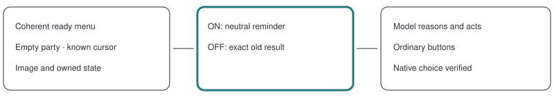

DEFAULT OFF · GUIDANCE · DIAGNOSTIC

# Notice the starter decision. Keep the choice with the model.

> Markdown twin of [starter-decision-salience-v1.html](../starter-decision-salience-v1.html), generated from the HTML by `just explainer-twins`. The HTML is the source; edit it, not this file.

This treatment adds one neutral reminder at a verified ready starter menu. It supplies no species advice or comparative game facts.



The wrapper changes only observation text. It makes no extra emulator request and executes no extra input.

## OFF

Existing screenshot, readout, tools, controls and goal. No new reminder.

## ON

The same observation ends with:

```
Starter decision: This choice determines your starting Pokémon and affects later play. Before confirming, consider the alternatives and briefly explain how your choice supports your goal. Distinguish what you know from what you are uncertain about.
```

## Exact activation boundary

`screen=starter_choice; started=true; in_battle=false; party=[]; active_ui.phase=starter_selection; ready=true; diagnostic=null; selected` is a verified starter name. A coherent image must accompany the state. Every qualifying returned selection observation gets the same idempotent reminder.

Confirmation, animation, unknown ownership, diagnostic errors and an acquired party add none. The phrase is harness reasoning guidance, not a fabricated quote from the game.

Game owner: pret/pokeemerald `src/starter_choose.c`, `Task_StarterChoose`; reader `env/pokebench_env/menus.py`. Source reference731ad5bfd6e6f265508d0efcca0ba42f9dcf5881. Recorded fixture90bb state2906/result2907 supplies a real ready selection; state2922/result2923 supplies confirmation.

## What is measured

Recognition, truthful goal-related consequences, uncertainty, stated choice versus acquired species, and cost. A considered Torchic choice can succeed. Selecting another species without a reason earns no reasoning credit.

Prompt-only diagnostic:8 per arm,5-minute cap, shared first-arrival Route101 save, early native starter stop. The stop boundary is separate from the broad model goal. No selection tool or added Pokémon facts.

## Status

Candidate implementation and rehearsal; independent review, final qualification and landing recorded in the worklog. No measured run approved or launched. See the tracked diagnostic overview and rubric.
