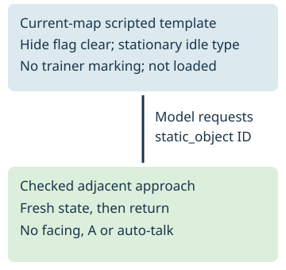

# Approach a qualified static template

> Markdown twin of [static-npc-template-approach-v1.html](../static-npc-template-approach-v1.html), generated from the HTML by `just explainer-twins`. The HTML is the source; edit it, not this file.

## Placement is evidence, not presence



The native idle movement types NONE (0) and FACE UP, DOWN, LEFT, RIGHT (7–10) do not wander. Scripts may still move these objects. Every placement remains qualified: current presence and position are unverified.

## Readout and tool contract

```
object 13 template at (19,27); approach only, no interaction
navigate_to_target target {"kind":"static_object","local_id":13}
```

The dedicated static_object intent prevents a loaded-on-entry race from falling into the ordinary live-object interaction path. If the object is now loaded, its template disappears, its evidence changes or input ownership changes, the call returns without interaction. The model chooses any later interaction.

Only current-map, unloaded, scripted templates qualify. The native map event count and canonical local ID/script bind the saved template to this map. Hidden, invisible-loaded, duplicate, moving, special/unknown flags, invalid coordinates and templates marked as trainers are excluded. No sprite label is promoted into a person's name.

## Actual recorded evidence

47c3 state 21850, RUSTBORO CITY map 0/3: qualified template IDs 7 at (24,51), 8 at (25,51), 13 at (19,27), with idle movement 10, 9, 8. A byte-for-byte archived native snapshot and provenance are replayed through production read_state, state_json and render. This proves reading and delivery, not current presence or gameplay benefit.

Game source revision 731ad5bfd6e6f265508d0efcca0ba42f9dcf5881: include/global.fieldmap.h ObjectEventTemplate; event_object_movement.c TrySpawnObjectEvents, MovementType_None and MovementType_FaceDirection; event_data.c FlagGet. Matching live slots are never replaced by template fallback.

## Switch and limits

static-npc-template-approach-v1 is default/control OFF and bundle ON. OFF preserves prior state/readout/prompt/tool schema and existing trainer-template treatment. ON adds an optional typed static_npc_templates field and the gated static_object target kind. Checked navigation preserves obstacles, trainer-sight checks, map/script/battle interruption and returns control; it selects no story destination.

Pending correctness candidate only. Start/load, exposure readiness, GPU budget and power/caps remain blocked. No experiment, gameplay, service or viewer restart is authorized by this page.
