Feature switch · observation · `status-names-v1` · default OFF · bundle arm only · pending experiment

# Status names

> Markdown twin of [status-names-v1.html](../status-names-v1.html), generated from the HTML by `just explainer-twins`. The HTML is the source; edit it, not this file.

The Party line names a Pokémon's status with the label the game's own party and summary screens show (PSN, PAR, SLP, FRZ, BRN), instead of the raw status number.

## Why

bd60 T688-706 (seq 18617-19141): for 19 turns the readout said `TORCHIC … STATUS 8` while its HP fell from 13 to 0 on the field, ending in a field-poison whiteout. 8 is the poison bit; nothing told the model the Pokémon was poisoned.

Operator rule (Operator, 2026-10-17): model-facing text says what the game itself would show. The game shows one ailment icon, picked by `GetAilmentFromStatus`, labelled with its own strings; it shows no sleep turn count and no separate bad-poison mark, so neither does the readout.

## What the model reads

```
OFF, bd60 seq 18617
Party (player): TORCHIC Lv11 HP 13/33 · STATUS 8 · moves SCRATCH PP 22, GROWL PP 40, FOCUS ENERGY PP 30, EMBER PP 23 · nickname TORCHIC
```

```
ON, bd60 seq 18617
Party (player): TORCHIC Lv11 HP 13/33 · STATUS PSN · moves SCRATCH PP 22, GROWL PP 40, FOCUS ENERGY PP 30, EMBER PP 23 · nickname TORCHIC
```

*Recorded RAM re-rendered on the real ROM with the switch off and on (env/tests/env/test_readout_truth_fixes.py). Nothing else in the readout changes.*

## How it decides



*The first bit set in this order gives the label, exactly as `GetAilmentFromStatus` does for the party and summary status icons.*

## Game grounding (pret/pokeemerald 731ad5bf, US ROM f3ae0881)

| Fact | Source | Value |
|---|---|---|
| Status bits | include/constants/battle.h:114-125 | POISON 1&lt;&lt;3, TOXIC 1&lt;&lt;7, … |
| Ailment order | `GetAilmentFromStatus` (src/party_menu.c:1909-1922) | PSN, PRZ, SLP, FRZ, BRN |
| Labels | `gText_Psn`, `gText_Par`, `gText_Slp`, `gText_Brn`, `gText_Frz` (src/strings.c:627-631) | PSN PAR SLP BRN FRZ |

## Limits

- Needs `expanded-menu-battle-information-v1`: only it shows the Party line's STATUS part.
- Battle lines keep their own status fields; only the Party line changes.
- A test reads the labels and the ailment order from the pokeemerald checkout when it is present.

## Status

A working branch (2026-10-17 top-50 run analysis, Group A); gates in `docs/worklogs/active/2026-10-17_readout-truth-fixes.md`. Server switch, default off, bundle arm only; registered as a pending experiment, not queued. Not reviewed or measured yet.
