# Story battle heal first line

> Markdown twin of [story-battle-heal-first-v1.html](../story-battle-heal-first-v1.html), generated from the HTML by `just explainer-twins`. The HTML is the source; edit it, not this file.

`story-battle-heal-first-v1` · guard · on in both arms (control and bundle) · default off · needs nothing

When a story battle the player cannot run from is on the current map and a party Pokémon is hurt, the harness puts one line at the very top of the game-tool result: each hurt Pokémon's HP, that the battle cannot be run from so heal first, the latest line about healing the model actually heard, and which exit of this map leads there.

The operator, 10:43 PM ET on 2026-10-20: "the heal first line needs to be in both control and the bundle".

## The probe it comes from

Probe ledger `story-battle-heal-first-20261020`: run 97a0 at turn 157, the turn the model walked to MAY at TORCHIC 5/22 and then whited out. 16 samples per arm on the recorded context, with only this line added right under the result's first line.

| Decision at turn 157 | Recorded result | With the line first | p |
|---|---|---|---|
| Walks to MAY | 13 / 16 | 4 / 16 | 0.004 |
| Heads south (toward OLDALE TOWN) | 0 / 16 | 11 / 16 | &lt;0.001 |

## Where the line goes

*The same line, one place: first in the result, under the trust header only when the result starts with it.*

## When it fires

*Every result is checked on its own state; there is no once-only arm, so the line stays first until the party is healed, the battle is won or the player leaves the map.*

| Story battle | Map | Unbeaten when | Present when | Pronoun |
|---|---|---|---|---|
| Route 103 rival (MAY or BRENDAN) | ROUTE103 (0/18) | FLAG_DEFEATED_RIVAL_ROUTE103 clear | the rival's sprite is loaded, or the readout's own Story characters line places the rival here (the map's object list, so FLAG_HIDE_ROUTE_103_RIVAL is respected) | from the rival the game chose by the player's gender |
| ROXANNE | RUSTBORO CITY GYM (11/3) | her trainer flag clear | always: her map object has no hide flag, so loaded or not | her |
| TEAM AQUA grunt | PETALBURG WOODS (24/11) | his trainer flag clear | always on that map; his battle starts from coord events, not a talk | he / him |

## Where the heard line points (97a0)

*The line names OLDALE TOWN. ROUTE103 has no warp into OLDALE TOWN's POKéMON CENTER, so the exit named is the town's: the SOUTH edge connection from the game's map table.*

How the place is found, in order: a map-table name the heard line contains (the longest), with that town's POKéMON CENTER 1F tried first; otherwise, if the page was heard inside a POKéMON CENTER or is MOM's heal line at home, that building and then the town its warps lead to. The first of those an exit of this map leads to is named: "*place* is the SOUTH edge of this map." or "*place* is the warp at (x,y) of this map."

Heard means delivered: a dialogue-auto-advance page whose result came back without an error, or a page of this very result. Battle pages do not count. Who said it is the conversation ledger's rule: the game's NAME: prefix, a name the game printed for that sprite on that map, or the sprite described ("A boy").

## What the model would have read

97a0 turn 156, result 4541 (bundle arm, so under the header):

Read from game memory, always true: TORCHIC has 5/22 HP. MAY's battle cannot be run from, so heal before talking to her. A boy on ROUTE101 told you: "There's a POKéMON CENTER in OLDALE TOWN right close by." OLDALE TOWN is the SOUTH edge of this map. Exits you can walk to from where you stand: SOUTH edge -&gt; OLDALE TOWN (map 0/10) …

This is the probed text exactly. Replaying 97a0, it would first have appeared at turn 149 (TORCHIC 17/20), and on every free-field result on ROUTE103 after that.

b300 entering RUSTBORO CITY GYM, result 14882 (ROXANNE at (5,2) out of view; the latest heal line heard was MOM's at turn 315; none of the gym's exits leads to the house):

TORCHIC has 25/33 HP. ROXANNE's battle cannot be run from, so heal before talking to her. MOM in RED's HOUSE 1F told you: "I think you should rest a bit."

Nothing heard (b300 on ROUTE103 at turn 261):

TORCHIC has 17/21 HP. MAY's battle cannot be run from, so heal before talking to her.

## With story-battle-heal-gate-v1 on

The gate's refusal is a result like any other and passes through the same outermost wrapper, so it leads with the same line built by the same function. The gate's own words are unchanged. 97a0 turn 157, navigate_to_target MAY, switch on (wiring test with harness-trust-v1 on):

Read from game memory, always true: TORCHIC has 5/22 HP. MAY's battle cannot be run from, so heal before talking to her. A boy on ROUTE101 told you: "There's a POKéMON CENTER in OLDALE TOWN right close by." OLDALE TOWN is the SOUTH edge of this map. Exits you can walk to from where you stand: SOUTH edge -&gt; OLDALE TOWN (map 0/10) … Semantic navigation: not started: it would start a trainer battle you cannot run from while your party is not at full HP. Selected map object 2. Battle not started: talking to your rival MAY (object 2, at (10,3)) starts a trainer battle, and your party is not at full HP: TORCHIC 5/22. …

Off, the refusal is byte for byte today's. The gate's pronouns now come from the same trainer-gender table as this line; the words they produce are unchanged.

## Game grounding

| Fact | pret/pokeemerald |
|---|---|
| The rival battle cannot be fled | Route103_EventScript_Rival: trainerbattle_no_intro; the game says sText_NoRunningFromTrainers "No! There's no running from a TRAINER battle!" |
| Which rival stands on Route 103 | Common_EventScript_SetupRivalGfxId: checkplayergender; a male player gets OBJ_EVENT_GFX_RIVAL_MAY_NORMAL, a female player RIVAL_BRENDAN_NORMAL |
| Trainer genders | src/data/trainers.h: TRAINER_MAY_ROUTE_103\_\* and TRAINER_ROXANNE_1 carry F_TRAINER_FEMALE; TRAINER_BRENDAN_ROUTE_103\_\* and TRAINER_GRUNT_PETALBURG_WOODS do not |
| ROXANNE is always on her map | data/maps/RustboroCity_Gym/map.json: OBJ_EVENT_GFX_ROXANNE at (5,2), flag 0 |
| The rival can be hidden | data/maps/Route103/map.json: OBJ_EVENT_GFX_VAR_0 at (10,3), FLAG_HIDE_ROUTE_103_RIVAL |
| MOM's heal line | PlayersHouse_1F_EventScript_MomHealsParty: msgbox PlayersHouse_1F_Text_YouShouldRestABit, whose last page is "I think you should rest a bit." |

## Wiring and record

*Off: no wrapper, no subscription, no event; prompt and tool list are identical on or off.*

## Status

A working branch from main 900a5c47. On in both arms of bundle-v-control, bundle-cook-1h and whole-map-cook-1h. Tests replay 97a0 result 4541 and b300 result 14882 and check the gate refusal; review and measured runs are separate steps. No benefit is claimed beyond the probe above.
