Harness switch · observation · `story-destinations-v1` · needs `dialogue-auto-advance-v1` · off by default · bundle arm

# Story destinations

> Markdown twin of [story-destinations-v1.html](../story-destinations-v1.html), generated from the HTML by `just explainer-twins`. The HTML is the source; edit it, not this file.

When a story character's latest line names a place ("head back to the LAB", "come by my POKéMON LAB later", "He lives right next door"), the readout says which map that is and where its door or edge is, using the game's own map table. The line itself is quoted, with its speaker, only to show what was resolved; the block lists no people (operator decision 2026-10-17). A name the map table does not pin to one map is reported as not resolved, never guessed.

## The miss it targets

Run `2026-10-16T12-42-29_qwen36-gpu0_4caa`, turn 272: after the Route 103 battle MAY says "Well, it's time to head back to the LAB." At turn 273 the model thinks "head back to the LAB (Rustboro City)" and walks south toward Oldale. Back in Littleroot it took its own house door for the lab (T469–T504). In `2026-10-16T02-23-17_qwen36-gpu1_sh02` turn 74, MOM says PROF. BIRCH "lives right next door"; at turn 75 the model sets off for "Professor Birch's Lab". The overnight run analysis counted this misreading of story destinations as the most common mistake (7 runs).

A later audit found a separate harness bug: Norman's Petalburg Gym instruction is printed by the game as `DAD: Now… Head for RUSTBORO CITY…`. The conversation ledger kept it, but this feature admitted `NORMAN` and rejected `DAD`, so the line never became a destination candidate. The source-backed alias `DAD → NORMAN` now applies only at character eligibility; the readout still quotes the game's label `DAD`. This does not change how long a destination remains active.

## Before and after, recorded T273

Off (what the model got)

```
Story: player name confirmed; … Route 103 rival battle won
Player: RAED
Location: ROUTE103
Position: X=9, Y=13, facing down
```

On (same result, replayed)

```
Story: player name confirmed; … Route 103 rival battle won
Latest story line naming a place (turn 272, MAY): "Well, it's time to head back to the LAB."
- "LAB" = PROF. BIRCH'S POKéMON LAB (map 1/4). Way in: door in LITTLEROOT TOWN (map 0/9) at (7,16).
Player: RAED
Location: ROUTE103
Position: X=9, Y=13, facing down
```

Actual output: the T273 test replays the recorded events of 4caa through the switch and asserts these exact lines. Nothing else in the readout changes, and the story line is shown whole.

## How a line becomes a target



*One claim: every fact in the block comes from recorded dialogue or the ROM's map table. The only words the harness knows by heart are the story characters' names (character-presence-v1's table) and "lives".*

## Game grounding: Littleroot's doors


*Sketch, not to scale. The coordinates are the ROM's WarpEvents for map 0/9 (pret/pokeemerald 731ad5b `data/maps/LittlerootTown/map.json`: (14,8) MAYS_HOUSE_1F, (5,8) BRENDANS_HOUSE_1F, (7,16) PROFESSOR_BIRCHS_LAB), checked by `env/tests/env/test_places.py` against the operator's ROM. Names are the readout's: with displayed-place-names-v1 the houses take their sign text, so for a male player MAYS_HOUSE is "PROF. BIRCH'S HOUSE". The ROM table is read rather than the vendor's map files because those disagree with the ROM on the Lavaridge gym's warps.*

## Rules, from the tests

| Line | Block says |
|---|---|
| DAD: "Now… Head for RUSTBORO CITY beyond this town." | `DAD` is accepted as Norman's exact game-printed alias, while the quote stays labelled `DAD`; "RUSTBORO CITY" resolves to RUSTBORO CITY (map 0/3). A faced sprite called DAD or `WALLYS DAD` does not use the alias. |
| MAY: "Well, it's time to head back to the LAB." | "LAB" = PROF. BIRCH'S POKéMON LAB (map 1/4). Way in: door in LITTLEROOT TOWN (map 0/9) at (7,16). |
| PROF. BIRCH: "…come by my POKéMON LAB later, okay?" (the cutscene then moves the player into the lab) | "POKéMON LAB" = PROF. BIRCH'S POKéMON LAB (map 1/4). You are in it now. |
| MOM: "PROF. BIRCH is his name." / "He lives right next door…" | "He lives" (He = PROF. BIRCH, the one story character named before it in this conversation) = PROF. BIRCH'S HOUSE 1F (map 1/2). Way in: door in LITTLEROOT TOWN (map 0/9) at (14,8). |
| MAY: "The POKéMON found on ROUTE 103 include…" (read in Oldale) | "ROUTE 103" = ROUTE103 (map 0/18). Way in: this map's NORTH edge; ROUTE110 (map 0/25) WEST edge; door in ALTERING CAVE (map 24/106) at (…). |
| "Go to the POKéMON CENTER, then to the GYM." | "POKéMON CENTER": not resolved: N maps in the game's map table match this name, and the line does not say which. (same for "GYM") |
| "WALLY and STEVEN came by." / "He lives right next door." | "He lives": not resolved: "He" could be WALLY or STEVEN. |
| "ROXANNE lives far away." | "ROXANNE lives": not resolved: no map in the game's map table is named ROXANNE'S HOUSE. |
| the map table cannot be read | Latest story line naming a place: not known; the game's map table could not be read (HTTP 503). (Which line names a place depends on the table, so no line is picked.) |

A line spoken by someone who is not a story character (May's mother, the nurse), a sign, battle text, or a newer story line that names no place never replaces the latest one; naming only a person does not make a line the latest. A call's own line counts in that call's result; a call whose result failed was never shown and does not count.

## Measured on recorded runs (replay, no model in the loop)

Replayed with `packages/agent/test-support/measure-story-destinations.ts` over 13 runs of 2026-10-16 (02:23 AM to 2:44 PM New York time) against the map table read from the ROM. Six runs had dialogue auto-advance off (control arm), so they record no dialogue pages and the block never shows; the switch needs that switch.

| Measure | Value |
|---|---|
| Bundle runs with dialogue pages | 7 (sh02, 230d, 7ccf, a3c9, 4caa, 8b01, d32e) |
| Overworld results with the block, those runs | 3,220 of 3,310 (97%); it first appears at T48–T72, MOM's "Well, this is LITTLEROOT TOWN." (replayed again on 2026-10-17 after the people lines were dropped; d32e had grown from 240 to 408 overworld results since the first replay) |
| Distinct story lines shown | 26 (each prints at least one place line) |
| Place resolutions printed (distinct lines) | 26: LITTLEROOT TOWN 7, "He lives" → PROF. BIRCH'S HOUSE 1F 7, "POKéMON LAB" 7, "LAB" 4, "ROUTE 103" 1 |
| Wrong resolutions | 0 of 26, each checked against pokeemerald's map data |
| Not resolved (ambiguous / no match) | 0 in these runs |
| People lines | 0 (none are listed) |

## Status

- Alias correction a working branch. Default off; registered as the pending experiment `experiments/story-destinations.json` (not queued), whose arms have `dialogue-auto-advance-v1` and `displayed-place-names-v1` on, as the bundle arm does (`character-presence-v1` stays as the finals incumbent has it; the block no longer uses it). Without displayed place names the table names the lab LITTLEROOT TOWN PROFESSOR BIRCHS LAB, so "LAB" still resolves but "POKéMON LAB" and "He lives" (PROF. BIRCH'S HOUSE) are reported as not resolved.
- Not done: measured runs. Whether the model uses the block is untested; only the operator approves runs.
- Decision probes (`just probe-decision`) have no game server, so a probe with this switch on says the map table could not be read.
