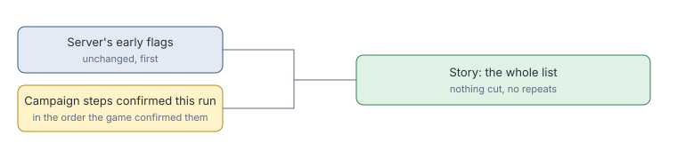

# Story line campaign steps

> Markdown twin of [story-line-campaign-flags-v1.html](../story-line-campaign-flags-v1.html), generated from the HTML by `just explainer-twins`. The HTML is the source; edit it, not this file.

`story-line-campaign-flags-v1` makes the readout's `Story:` line keep growing with the run, instead of stopping at the server's early flags.

## Why it exists

The game server reads a fixed set of early flags, ending around `route104 cindy defeated`. A long run still saw that same line, while the supervisor briefing listed the later steps.

## What changes

*The briefing no longer lists a step twice once the Story line carries it.*

## What counts

The same steps the supervisor briefing lists: story milestones in the extended campaign catalog that the game confirmed during this run. Optional activities are left out. So are steps already done when the run started, unless `story-line-start-steps-v1` is on, as it is in the current recipe. A step shows on the result that confirmed it, or at the latest on the next one. Only results carrying a game readout change.

## Off

The Story line lists the server's flags only.
