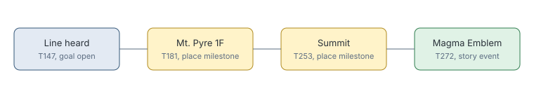

# Story line done on event

> Markdown twin of [story-line-done-on-event-v1.html](../story-line-done-on-event-v1.html), generated from the HTML by `just explainer-twins`. The HTML is the source; edit it, not this file.

`story-line-done-on-event-v1` keeps a place-naming line as the goal until the game confirms something happened, not just that the player arrived.

## Why it exists

A line counted as done on first entry to its place plus any later step, and a place milestone on that same arrival was enough. So the goal "move out to MT. PYRE" vanished on the first step onto Mt. Pyre 1F, and the Meteor Falls line vanished on Route 114.

## The rule

*From run a0b4. Each milestone already records its kind: navigation for a place reached, story for an event.*

## Where the event can be

A story event after the arrival is either at the place or after the player has left it, so one test covers both. The second case keeps a line from lingering once the story has moved on, and a retired line stays retired if the player walks back.

## What it does not use

No table of what should happen where. Only milestones the game has already confirmed.

## Off

Any later step finishes the line, a place reached included.
