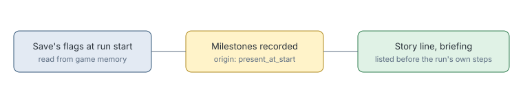

# Story line start steps

> Markdown twin of [story-line-start-steps-v1.html](../story-line-start-steps-v1.html), generated from the HTML by `just explainer-twins`. The HTML is the source; edit it, not this file.

`story-line-start-steps-v1` makes a run started from a checkpoint list what its save has already done.

## Why it exists

A checkpoint run begins with badges and story steps it never earned on screen. The Story line jumped from the server's early flags to the first step of the run, so run ee2a skipped Knuckle through Balance badges.

## Where the steps come from

*Nothing the save does not hold gets in. A run from boot has none of these, so it is unchanged.*

## What does not change

These steps are listed as done. They do not count as progress in this run, so stall clocks and notes are not affected.

## Off

Only steps confirmed during the run are listed.
