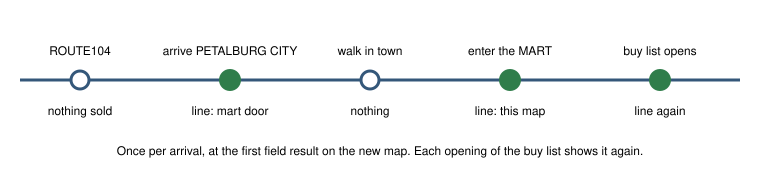

# Supplies (supplies-v1)

> Markdown twin of [supplies-v1.html](../supplies-v1.html), generated from the HTML by `just explainer-twins`. The HTML is the source; edit it, not this file.

Bundle arm only, default off. Approved by the operator on 2026-10-27, reworked the same day at the operator's request. On arrival on a map where something can be bought, or that has a door into one, one line sets the player's money next to the balls and healing items in the BAG, the party size and the places on the map that sell things. It shows again whenever a shop's buy list opens. No advice. mart-stock-readout-v1 still lists what the shop sells.

## Why on arrival, not inside the mart

Run 429f (Astra) made six mart visits and bought something every time. Each time it said it would shop before it went in: 0 to 5 turns earlier, on the town map or in a building next to it.

| Mart | First said, outside | Entered | Bought |
|---|---|---|---|
| RUSTBORO CITY MART | t347, RUSTBORO CITY: "Visit the nearby Mart to buy healing supplies before gym battles." | t348 | POTION ×4 |
| SLATEPORT CITY MART | t931, OCEANIC MUSEUM 1F: "…leave the museum and stock up on capture supplies before heading north." | t936 | SUPER POTION ×3, GREAT BALL ×5 |
| MAUVILLE CITY MART | t1315, POKEMON CENTER 1F: "Party fully restored. Leave to buy supplies." | t1319 | SUPER POTION ×8, PARLYZ HEAL ×5, ANTIDOTE ×3, AWAKENING ×3 |
| FALLARBOR TOWN MART | t1782, FALLARBOR TOWN: "Visit the Mart to replace healing items spent in the double battle." | t1784 | SUPER POTION +8, ESCAPE ROPE ×2 |
| LAVARIDGE TOWN MART | t2210, LAVARIDGE TOWN: "Visit the Mart for additional healing supplies before the next gym." | t2210 | SUPER POTION +6, REVIVE ×3 |
| LAVARIDGE TOWN MART | t2431, LAVARIDGE TOWN: "Enter the Mart for replacement healing supplies." | t2431 | SUPER POTION ×10, ANTIDOTE +2, REVIVE +2 |

Quotes are Astra's per-turn assistant text; purchases are the BAG change between its first and last state in each mart.

## When it shows



## Where things can be bought (game data)

| Source in pret scripts | Maps |
|---|---|
| `pokemart`, `pokemartdecoration`, `pokemartdecoration2` | every POKé MART; SLATEPORT CITY (market); LILYCOVE CITY DEPARTMENT STORE 2F–5F and ROOFTOP; ROUTE104 PRETTY PETAL FLOWER SHOP; LAVARIDGE TOWN HERB SHOP; FORTREE CITY DECORATION SHOP; BATTLE FRONTIER MART; TRAINER HILL ENTRANCE; EVER GRANDE CITY POKEMON LEAGUE 1F |
| scripts that take money, coins or BP for something | BATTLE FRONTIER EXCHANGE SERVICE CORNER and LOUNGE7 (BP); MAUVILLE CITY GAME CORNER; MT CHIMNEY (LAVA COOKIE); ROUTE109 SEASHORE HOUSE (SODA POP) |
| left out: they buy nothing | SAFARI ZONE and OCEANIC MUSEUM entry fees; LOUNGE3 wager |

The current map and its doors come from the game's map table (`GET /pokebench/places`, read from the ROM). A warp on this map into one of these maps names it with its door tiles. A test checks that every listed name is in the map table.

## Recorded examples: run 057c

Built by the tests from 057c's own states. Its first state in PETALBURG CITY (turn 252):

```
Supplies: ₽1,992 · balls: POKé BALL ×5 · healing and status items: none · party 1 of 6 · places on this map that sell things: PETALBURG CITY MART, door at (25,12)
```

Its first state inside PETALBURG CITY MART (turn 298):

```
Supplies: ₽3,440 · balls: POKé BALL ×5 · healing and status items: none · party 1 of 6 · places on this map that sell things: PETALBURG CITY MART (this map)
```

Arriving on ROUTE104 shows nothing. SLATEPORT CITY lists itself and its mart door. An empty list says "none"; money the state cannot read says "unknown".

## Off and on

| Off | On |
|---|---|
| No line. Results are today's bytes. | The line is appended after the readout on those results only. The map table is read once per run. |

## Status

Unit tests on 057c's states and a production-path test through `playGameTools` (red with the wiring removed). Review in progress; no measured runs or probes.
