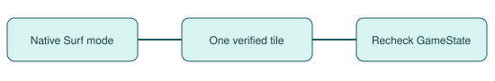

# Surf movement and refusals

> Markdown twin of [surf-navigation-correctness-v1.html](../surf-navigation-correctness-v1.html), generated from the HTML by `just explainer-twins`. The HTML is the source; edit it, not this file.

## Route 128

A direction batch previously refused the first ocean tile while the player was already surfing. The guard now reads the native avatar mode and uses the navigator’s Surf geometry. It submits a verified single-tile water stride and checks the returned state before sending another.

A Surf refusal identifies a known solid destination or forced-water tile when available. When a route is unverified, the message gives the endpoints. The switch’s off setting keeps the previous guard and refusal text.
