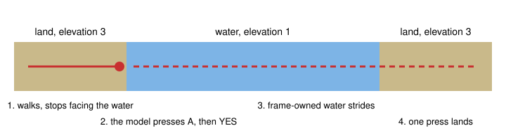

# Native Surf navigation

> Markdown twin of [surf-navigation-v1.html](../surf-navigation-v1.html), generated from the HTML by `just explainer-twins`. The HTML is the source; edit it, not this file.

`surf-navigation-v1` makes surfing a mode of the same A\* search that walks the land. The planner knows what the terrain does. Only the model uses a move.

## Why

Run 274b was the first of 800 recorded runs to get Surf. At turn 1861 the guard refused 8 RIGHT presses and said to use a navigation tool. At turn 1862 `navigate_to` refused because water was a wall, even while surfing. The agent crossed with single presses: 9 turns where 3 should do. Turns 1836, 1837 and 1848 went to counting map rows by hand to find a shore.

## One route over land and water



*Solid: the first call. Dashed: the second call, after the model starts Surf. One search chooses the shore tile for the whole route.*

## What the search may do

| From | Onto | Result | Game source |
|---|---|---|---|
| Foot | Water | Never walked. A launch search uses it to find the shore tile, and the walk stops there. | IsPlayerFacingSurfableFishableWater: player at elevation 3, step is an elevation mismatch |
| Water | Plain water 0x10, 0x11, 0x12, 0x14, 0x15 | A stride. A held press moves two tiles, so these are frame-owned. | PlayerWalkFast |
| Water | Bridge tiles 0x70 to 0x73, 0x7a to 0x7d at elevation 15 | Passes under, in the same stride. | IsElevationMismatchAt: 15 never mismatches |
| Water | Current 0x50 to 0x53 | Rides to where the push ends. Refused when the push ends against the shore. | DoForcedMovement |
| Water | Waterfall 0x13 | Rides down. Going up, the walk stops at the foot when Waterfall can be used and says to press A; otherwise the route refuses and names what it needs. | IsPlayerSurfingNorth, MB_WATERFALL forced south |
| Water | Water warp 0x6c, 0x6d | Only as the goal. | MetatileBehavior warp tables |
| Water | Land at elevation 3, no object there | Lands. A route can land but never re-enter water. | CanStopSurfing |
| Water | Land at another elevation | Wall. | CanStopSurfing |

The same rule covers every field move: the harness never starts Surf, Waterfall, Dive, Cut or Rock Smash. A closed waterfall stays a wall on foot.

## What the model reads

```
Navigation: stopped at the shore at (25,12), facing the water at (26,12): the way to (28,12) crosses water, and navigate_to does not start Surf; press A while facing the water to use it; 15 bounded movement actions.
```

```
Exits you can walk to from where you stand: WEST edge -> MAUVILLE CITY (map 0/2). Across water: NORTH edge -> ROUTE 119 (map 0/34).
```

```
You are surfing. Exits by water or land from here, not counting currents and waterfalls: NORTH edge -> ROUTE 119 (map 0/34); WEST edge -> MAUVILLE CITY (map 0/2).
```

The first line is from the emulator rehearsal. The other two show the format, with 274b's Route 118 exits filled in as an example.

## Off and on

Off: water is a wall while surfing, the exit line and system prompt are unchanged, connections have no `water_edges`, and strides refuse to run on water. On, in both arms of the current recipe by operator decision.

## Status

Rehearsed on the real emulator with a scratch save, on Route 104: shore stop, the model's A press, a water route with bends stopping on exact tiles, wild encounters mid-stride, landing, and a map exit by `navigate_to_target` from water. Currents, waterfalls and water warps are covered by planner tests only, because no save reaches one. Merging does not change run 274b, which is pinned.
