Harness switch · guard · `text-only-supervisor-v1` · off by default

# Text-only supervisor

> Markdown twin of [text-only-supervisor-v1.html](../text-only-supervisor-v1.html), generated from the HTML by `just explainer-twins`. The HTML is the source; edit it, not this file.

Without this switch, three replies in a row that call no tool end the run as a model error. With it on, the run gets a SUPERVISOR note instead and keeps going. The note says where the player is and what the game has shown, and that only a tool call changes the game. The run still ends after three notes in a row with no tool call between them.

## Why

On the 32 Think Fast 2×2 runs, this stop ended 5 runs. All 5 ended on three replies in a row with no tool call, often long lists of coordinates. Four had made no progress since about minute 2. One, trial 04, had met the rival at 11.2 minutes and stopped at 13.7. Winner-gate finals give each run 45 minutes, so each early stop throws away more play.

## Off and on, side by side



*Same three text-only replies. Off ends the run at the failure limit. On sends one recorded SUPERVISOR note in place of the usual "Keep playing" nudge, restarts the count and waits for a tool call.*

## The bound


*At most 3 notes in a row (`TEXT_ONLY_NOTE_LIMIT`). A model that never calls a tool still ends after 12 replies, so it cannot burn the whole budget. Only a streak made entirely of replies with no tool call earns a note; if a gateway error or an invalid tool call is part of the streak, the run ends at the limit as before. The note is recorded when it is delivered, so a run that stops on that turn records none. State-only decision runs send no follow-up messages and must keep the switch off.*

## What the model sees

The note is built from the loop supervisor's recorded facts. Illustrative example, not a recorded run:

```
SUPERVISOR: Your last 3 replies called no tool, so nothing happened in the game (text-only supervisor, note 1 of 3). Writing out a plan or a list of coordinates does not move you; only a tool call does.
Get your bearings:
- Where you are: LITTLEROOT TOWN MAYS HOUSE 2F at (7,2) facing up
- Last story progress: …
- Story steps the game confirms are done: …
- Recent dialogue you were shown, newest first: …
- Listed here that you have not tried yet: …
Keep your thinking short and end this reply with one tool call: observe to look again, or press, navigate_to or another listed tool to act. If replies keep calling no tool after note 3 of 3, the run ends.
```

## Recording and wiring

| Piece | What it does |
|---|---|
| Preset or switchboard | `text-only-supervisor-v1`, default off. Winner-gate finals turn it on for every arm, the incumbent included, except state-only decision arms. |
| Governor (`harness.ts`) | At the failure limit on a reply with no tool call (text only, or cut off at max_tokens with none), it sends the note instead of stopping. |
| Event | `text_only_supervisor`: replies, note number, limit and the exact note text the model received. |
| Viewer | Error lane, Activity History and trace show each note. |

## Status

Unit, live-path and viewer tests pass. Not yet measured on its own; it has a pending experiment entry. Finals use it in every arm, so it does not favor any finalist.
