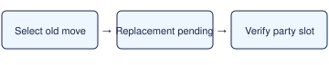

# TM/HM learning visibility

> Markdown twin of [tmhm-learning-visibility-v1.html](../tmhm-learning-visibility-v1.html), generated from the HTML by `just explainer-twins`. The HTML is the source; edit it, not this file.

Enabled in both arms of the current recipe and in the Opus Rayquaza lane.

*The game changes the party slot after the forget message completes.*

## What the agent sees

The readout identifies the native TM/HM message task and distinguishes printing, an A/B acknowledgement wait, and the learned-move message. After choosing the old move, `learn_move` reports pending until it can verify the exact replacement in the same party slot.

## Recorded verification

In run `f58e`, Rest was still present at event 471 and Waterfall was present at event 516. Re-decoding those frames verified the distinction. In retry `cc7d`, the tool reported both replacements as pending and Rayquaza had Fly, Waterfall, Aerial Ace, and Outrage on turn 56.
