# Every tool in the system prompt

> Markdown twin of [tool-prompt-docs-v1.html](../tool-prompt-docs-v1.html), generated from the HTML by `just explainer-twins`. The HTML is the source; edit it, not this file.

`tool-prompt-docs-v1` · guidance · default OFF · proposed for both arms

The model is given a list of tools, each with its own short description, and a system prompt that explains how to play. With this switch on, every tool in the list is also named in the system prompt. Before it, two tools were offered but never mentioned in the prompt: `choose_evolution` and `battle_action`. In a just-in-time scene, five more tools were kept in the list while the prompt section that names them was dropped.

## What went wrong

Control run `2026-10-21T13-33-36_qwen36-gpu1_d548` (bundle-v-control-2h, pin 4590d681) won a trainer battle at turn 555 (seq 20434). Its TORCHIC then started to evolve, and the game waited for `choose_evolution`: ordinary buttons are blocked at that screen. The model called `navigate_to_target` on object 21 for 85 turns instead and was still at the evolution decision at turn 662 (seq 22321), more than 100 turns later.

`evolution-decision-v1` is on in both arms, so `choose_evolution` was in the run's tool list. The run's system prompt (15,881 characters in its `run_start` event) never names it.

## Tool list and prompt, OFF and ON



*OFF, two tools in the list have no words in the system prompt, only their own tool description. ON adds one section for each, appended before the harness-trust section.*

## Just-in-time scenes

With a just-in-time prompt (`just-in-time-prompt-v1/v2`), the system prompt is cut to the sections of one scene, such as `battle` or `menu`. The overworld-only sections were dropped there, but five tools they name stayed in the list. ON adds one line for each kept tool whose own section the scene hides, unless the scene's prompt already names it.


*Per-scene gap the audit found in `battle` (and `menu`): five tools kept, their sections hidden. `choose_evolution` was missing in every scene.*

## What the model sees ON

The two new sections, exactly as appended:

```
- choose_evolution: when the readout shows an evolution waiting for choose_evolution, call it with decision evolve (the evolution completes) or cancel (it stops). Ordinary buttons are blocked until you choose. Neither option is recommended. Move-learning prompts afterward use their own controls. It refuses, and presses nothing, when no evolution is waiting.
```

```
- battle_action: while a battle waits for your choice, chooses fight with move (a move your active POKéMON knows), bag, pokemon or run in one call. The harness moves the battle menu's highlight and presses A, checking the cursor after each press, and refuses without pressing when no battle is waiting for a choice, the active POKéMON does not know the move or the move has no PP. bag and pokemon stop on the BAG or POKéMON screen; choose there with press. YES/NO choices are not handled; use press.
```

The five scene lines:

```
- get_dialogue: searches every dialogue page the harness advanced through this run, by speaker, words, map or recency. It presses nothing.
- recall_dialogue: searches every dialogue page you have been shown this run, newest first. It presses nothing.
- remember_destination: optionally keeps your destination hypothesis, grounded in navigation ledger events, across context pruning. It presses nothing.
- note_contradiction: records that the game differed from what you expected, citing 1–4 event numbers. It changes nothing in the game.
- get_next_milestone: tells you the next main story milestone the game has not recorded yet. It presses nothing.
```

Each line restates the tool's own description; none recommends a choice. OFF, none of this text is in the prompt, and the prompt bytes are what they were before the switch existed.

## How it is held true

- **Property test** (`packages/agent/src/tool-prompt-sync.test.ts`): with the switch on, every tool from `toolNames(features)` is named in `playSystemPrompt`, for the full prompt and every just-in-time scene, over 221 feature sets (default flags, both arms of all 25 fixed cohorts, the 7 control bases and every experiment arm). 890 cases; 416 failed before the fix.
- **OFF bytes**: the full and per-scene prompts are pinned by sha256, taken before the switch existed.
- **Rule for later tools**: `.claude/skills/tool-prompt-sync/SKILL.md` says adding, renaming or removing a model tool updates its prompt section in the same change, behind the tool's switch (the operator 2026-10-21: "everytime u add a tool u update the system prompt").

## Status

- RED 2ee4ba856, GREEN 3e9253c33. Not merged into main.
- Default OFF. ON in both arms of the fixed bundles (the operator, 2026-10-21 10:44 PM ET).
- Multi-model review: not run yet (one branch packet before landing).
- Not measured in runs. Pending experiment: `experiments/tool-prompt-docs-v1.json`.
