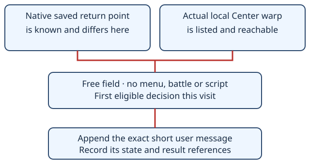

# Town Center checkpoint

> Markdown twin of [town-center-checkpoint-v1.html](../town-center-checkpoint-v1.html), generated from the HTML by `just explainer-twins`. The HTML is the source; edit it, not this file.

## Establish the return point before continuing

Switch: `town-center-checkpoint-v1`. Registered default OFF; enabled in both control and bundle in the shared current configuration, as the operator requested. The first eligible field decision of a town visit gets the short instruction that won the matched-encoding comparison.

Entering a Center sets the local blackout return point even with a healthy party. Talking to the nurse restores HP, PP and status. The reminder asks for entry first, recovery if needed, then the current objective.

## What makes a reminder eligible



The game’s map table identifies the Center and doorway. The entrance must already appear in the delivered observation as a listed warp target; the reminder does not reveal an unseen building. The native reachability label must be foot; water, none or missing reachability suppresses it. Unknown checkpoint data, non-player party, ambiguous readouts and unsupported UI states also suppress it.

Locked arrival dialogue defers delivery until a fresh successful result shows the field is free. The note is transient and appears last, after other context transforms, as a plain text string. OFF returns the original transform and records no note.

## Actual tested wording

```
Enter OLDALE TOWN’s Pokémon Center now, using the listed entrance warp at (6,16) on map [0, 10]. Entry sets your blackout return point here even when your party is healthy. Heal with the nurse if needed, then resume your current objective.
```

The town, map and doorway come from current verified facts. Rustboro substitutes RUSTBORO CITY, (16,38) and \[0, 3\]. No movement is executed, and no gym action is blocked.

## When it stops

A successful action consumes this visit’s notice; failed and text-only replies retain it. Leaving and returning rearms the visit check. Once the native saved return point is this town, no checkpoint reminder is sent. Recovery guidance remains separate. This is one notice per eligible visit, not the earlier unmerged draft’s three tool-result paragraphs.

Delivery uses the existing `ledger_context` event with exact text and the source state/result event numbers. Activity History shows “Instruction ledger delivered”; raw inspection retains the whole message and references. The timeline gains no marks.

## Game grounding

Reference pokeemerald commit `731ad5bfd6e6f265508d0efcca0ba42f9dcf5881`. OldaleTown_PokemonCenter_1F and RustboroCity_PokemonCenter_1F OnTransition scripts run `setrespawn`. The nurse’s `gText_WouldYouLikeToRestYourPkmn` says “We restore your tired POKéMON to full health.” SaveBlock1.lastHealLocation is already decoded by the existing heal-before-trainers reader; this feature adds no new RAM offsets.

## Evidence and status

Matched-encoding comparison: 64 decisions on four previously exposed source families. Healthy arrivals: long parent 6/16, short 16/16. Damaged Rustboro: 7/8 vs 8/8. Healthy, already checkpointed Rustboro: 8/8 in both. All request pairs used the same string encoding and differed only in final text. These are first-action results, not completed healing or full-game gains.

The production eligibility, visit deduplication and suppression rules have separate factory and pinned pi HTTP tests. Both future arms resolve the switch ON; historical frozen presets retain their recorded values. Branch implementation and validation receipts are in the town-center-harness worklog. Live activation and gameplay outcomes require their own evidence.
