Harness switch · guidance · `trainer-heal-guidance-v1` · needs nothing · off by default

# Trainer heal guidance

> Markdown twin of [trainer-heal-guidance-v1.html](../trainer-heal-guidance-v1.html), generated from the HTML by `just explainer-twins`. The HTML is the source; edit it, not this file.

One system-prompt section with the game's rules for trainer and rival battles: they cannot be fled, losing costs half your money and a trip back, and you should heal first when your Pokémon is below half HP. It is option A from the May whiteout options page and ships with `low-hp-trainer-warning-v1` (option B), which warns at the moment it matters.

## Why: run 54a7, turn 363 to 371

Round 2 bundle run `2026-10-16T04-51-03_qwen36-gpu0_54a7`. Every field readout from turn 362 to 368 showed TORCHIC at 3/21 HP and the battle-triage line "below half". On turn 363 the model wrote "Torchic has 3/21 HP, which is below half. I need to find May." It talked to MAY at 5:27 AM, fainted on the first Tackle, woke up in BRENDANS HOUSE 2F with ₽1500 of its ₽3000 left, then dropped the rival goal. The Oldale POKéMON CENTER was about 27 tiles away.

## What the model reads

```
Trainer battles and your rival: a battle against a trainer, including your rival, cannot be run from. If every Pokémon in your party faints, you black out: you lose half your money and wake up back at the last POKéMON CENTER you entered, or at home, far from where you were. Your rival usually battles you when you talk to them. Before you talk to a trainer or your rival, check your party HP in the readout, and if your Pokémon is below half its maximum HP, heal first: talking to the nurse at a POKéMON CENTER heals your whole party, and so does talking to MOM at home; a POTION or an ORAN BERRY from your BAG restores some HP.
```

Game rules only: it names no place, character or story step, the same rule `battle-triage-guidance-v1` follows.

## Where it goes in the prompt



*The only difference: one paragraph. OFF reproduces run 54a7's recorded system prompt byte for byte (test).*

## Game grounding (pret/pokeemerald)

| Fact | Source | Seen in 54a7 |
|---|---|---|
| Talking to the Route 103 rival runs a trainer battle; RUN is refused in trainer battles | `data/maps/Route103/scripts.inc` `trainerbattle_no_intro TRAINER_MAY_ROUTE_103_*` | T369 readout: `RUN REFUSED — "No! There's no running from a TRAINER battle!"` |
| A blackout halves money, heals the party and warps to the last heal location | `src/overworld.c` `DoWhiteOut`: `SetMoney(…, GetMoney(…) / 2)`, `SetWarpDestinationToLastHealLocation` | ₽3000 → ₽1500, TORCHIC 21/21, BRENDANS HOUSE 2F |
| Entering a POKéMON CENTER sets that heal location; before that it is home | `data/maps/OldaleTown_PokemonCenter_1F/scripts.inc` `setrespawn HEAL_LOCATION_OLDALE_TOWN` | No center entered before T371 |
| Rival battle won | `FLAG_DEFEATED_RIVAL_ROUTE103` (0x82), our `story.rival_battle_won` | `false` through T371 |

## Status

- Tests: registry, presets default OFF, OFF prompt equals 54a7's recorded prompt, ON adds exactly this paragraph, factory path; removing the wiring turns 2 tests red.
- Not yet measured. Joins the bundle arm of bundle-v-control by operator decision (2026-10-16); the readiness thread edits the bundle file.
