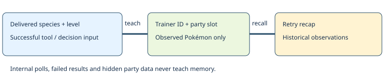

# Observed trainer Pokémon

> Markdown twin of [trainer-observed-party-v1.html](../trainer-observed-party-v1.html), generated from the HTML by `just explainer-twins`. The HTML is the source; edit it, not this file.

`trainer-observed-party-v1` · default OFF · bundle ON, control OFF · needs battle-loss-recap-v1

## Remember the battle the model actually saw



## The actual May trace

Run 2026-10-22T20-40-54_glm53-mac_0d5d delivered WINGULL Lv18 at result 138432, its faint at 138711, and GROVYLE Lv20 at 139096. The model later claimed it fought only GROVYLE.

### OFF

The existing result, whiteout and defeated-flag recap remains unchanged.

### ON — reconstructed output from those recorded deliveries

```
Previously observed against MAY (trainer 530): WINGULL Lv18 (last observed fainted), GROVYLE Lv20. Full party not established by these observations.
```

This does not list unseen teammates, party counts, moves, items or a plan. “Last observed fainted” describes the earlier observation; it does not claim a rematch starts with that Pokémon fainted.

## Evidence and lifetime

Species and level must both appear in the delivered readout and match its active opponent state. Delivered faint pages update only a previously learned species whose matching slot is fainted in the paired state. An unnumbered Foe line is accepted only when its species and level identify one opponent; numbered Battler lines distinguish identical opponents. Trainer identity can carry through the same recorded battle when a resolving state omits its opponent label. Memory persists across attempts and story milestones. The usual loss recap expiry is unchanged; active trainer battles can recall their own history after expiry.

Pending state and page correlations retain at most 512 entries each; each trainer retains up to six observed party slots. Different trainer IDs stay separate even when names match. One-trainer doubles record both opponent positions; multi and two-opponent battles are excluded because this state exposes only one trainer ID.

Game grounding: pret/pokeemerald 731ad5bfd6e6f265508d0efcca0ba42f9dcf5881, include/constants/battle.h (MULTI, TWO_OPPONENTS), src/battle_message.c (faint page). No trainer-party table is read.

## Validation status

Prepared on a working branch. Regression tests replay selected original state, dialogue and tool records through BattleOutcomes and playGameTools. Full gates, independent review and live activation are recorded in the feature worklog. No gameplay experiment is launched by this change.
