# Trainer sight check

> Markdown twin of [trainer-sight-check-v1.html](../trainer-sight-check-v1.html), generated from the HTML by `just explainer-twins`. The HTML is the source; edit it, not this file.

`trainer-sight-check-v1` · guidance · bundle arm only · default off · needs `bounded-navigation-v1`

Before `navigate_to` walks, the game server tests every tile of the planned route against the line of sight of every trainer on the map the player has not beaten, using the game's own rule. If a trainer can see a tile on the route, the walk does not start. The result says which trainer, which tile and the party's HP, and the model can walk anyway with `confirm_trainer_sight: true`.

## What happened in b300

| Seq | What happened |
|---|---|
| 15214 | The model's stated belief: "There is a YOUNGSTER at (3, 9) that I can battle, but I am low on health. I will just go to ROXANNE directly." TORCHIC had 11/35 HP. |
| 15231 | navigate_to to (5,2) on map 11/3 from (5,15). The route went west, then up column 1. |
| 15283–15568 | At (1,9) YOUNGSTER TOMMY saw it and walked up. Trainer battle; TOMMY beaten. |
| 15586 | Still on (1,9), HIKER MARC saw it too. It blacked out at 15755. |

## The route and the two sight lines

*RUSTBORO CITY GYM (map 11/3) from b300's state at seq 15233. Walls come from the map grid in that state. The route is the planner's path in that state, the same one the run walked. The shaded tiles are what each trainer can see under the game's rule, and the first route tile in sight is (1,9), step 12.*

## The game's rule

`CheckForTrainersWantingBattle` (src/trainer_see.c) runs whenever field input is processed. It checks every loaded object whose `trainerType` is NORMAL or BURIED. This switch applies the same test to each route tile, as if the player were standing there.

*Each box is one test from `CheckTrainer`, `GetTrainerApproachDistance` and `CheckPathBetweenTrainerAndPlayer`. A route tile is in sight only if all four pass for some stance of the trainer.*

## What the model would have read at turn 501

OFF (as recorded)

Navigation: walk interrupted: field controls are locked by a script and no message is open; the game is acting on its own, so inspect the new state before calling navigate_to again; 3 bounded movement actions. …three stride receipts: (5,16), (1,16), then up column 1, stopped at (1,9)… (seq 15275; YOUNGSTER TOMMY was walking up, and his battle followed)

ON (exact test output, from b300's raw RAM)

Navigation: not walked: a trainer you have not beaten can see the planned route; 0 bounded movement actions. Trainer sight: the route navigate_to planned from (5,15) to (5,2) (23 steps) passes tiles trainers you have not beaten can see. A trainer who sees you walks up to you and starts a battle. In a trainer battle the game says "No! There's no running from a TRAINER battle!" - object 3, sprite YOUNGSTER at (3,9) (loaded, its tile now), facing LEFT, sight 3 tiles: it can see (1,9), step 12 of 23 on the route. - object 5, sprite HIKER at (1,6) (not loaded; where the map places it, it may have moved), facing DOWN, sight 3 tiles: it can see (1,9), step 12 of 23 on the route. Your party: TORCHIC 11/35 HP. To walk this route anyway, call navigate_to again with the same x, y and map_id and confirm_trainer_sight: true. …the usual readout and screenshot follow…

With TOMMY beaten and the player on (1,9), the same check on a navigate_to to (5,2) names MARC alone. In the run itself no tool call came between the battles, because MARC already saw (1,9). So this result shows what MARC's line covers. It is not a warning the run could have received:

Trainer sight: the route navigate_to planned from (1,9) to (5,2) (11 steps) passes tiles a trainer you have not beaten can see. A trainer who sees you walks up to you and starts a battle. In a trainer battle the game says "No! There's no running from a TRAINER battle!" - object 5, sprite HIKER at (1,6) (not loaded; where the map places it, it may have moved), facing DOWN, sight 3 tiles: it can see (1,8), step 1 of 11 on the route. Your party: TORCHIC 11/35 HP. To walk this route anyway, call navigate_to again with the same x, y and map_id and confirm_trainer_sight: true.

A second call with `confirm_trainer_sight: true` walks the route as before. The check runs once per navigate_to call, on the first route the planner gives.

## Wiring

*The highlighted box is the only place behavior changes. OFF: no argument, no description or system-prompt sentence, no request and no event. Each check is one `trainer_sight_check` event with outcome clear, refused, confirmed or unavailable. It adds no timeline mark.*

## Game grounding (pret/pokeemerald 731ad5bf, US ROM f3ae0881)

| Fact | Where it is read |
|---|---|
| Template: tile, elevation, movement type and range, trainerType, sight, script, hide flag | `SaveBlock1 + 0xC70`, 64 × 24 bytes (struct ObjectEventTemplate) |
| Loaded object: trainerType, local id, map, elevation, coords, facing, range, sight | `gObjectEvents` 0x02037350, 16 × 0x24 (struct ObjectEvent) |
| Beaten | trainer id after `trainerbattle` (0x5C), flag 0x500 + id in `SaveBlock1 + 0x1270` |
| Collision, height, wall sides | live backup map (`gBackupMapLayout`), metatile behaviors `MB_IMPASSABLE_*` |
| No-running line | `sText_NoRunningFromTrainers`, src/battle_message.c |

b300 at seq 15233: object 3 YOUNGSTER (TRAINER_TOMMY 321) is loaded at (3,9) facing LEFT, sight 3. Object 5 HIKER (TRAINER_MARC 571) is not loaded; its template is at (1,6), FACE_DOWN, sight 3, range 1×1. JOSH (320) is beaten. These match data/maps/RustboroCity_Gym/map.json.

## What it does not cover

- **press** is not checked. A direction press moves one tile toward a trainer the model can see in its Field objects list. Checking it would add a confirm argument to the most-used tool and cost an extra call for every deliberate approach. b300's walk into both lines was a single 23-step navigate_to.
- navigate_to_target and other internal walks (`executeChecked`) are not checked. Re-plans after the first press are not checked either.
- The player's own previous tile is never treated as blocking the line, and trainers on a connected map are not checked. In both cases the check leans toward warning.
- When the game server cannot answer, for example because the map grid is unreadable or the request fails, the walk runs and the event says unavailable.

## Status

Tests: `env/tests/env/test_trainer_sight.py` (synthetic rule, endpoint, b300 raw RAM with the operator's ROM) and `packages/agent/src/trainer-sight.test.ts` (b300 refusal text, confirm, OFF, wiring). No measured runs yet. The pending experiment is `experiments/trainer-sight-check-v1.json`.
