# Trainer sight: target walks

> Markdown twin of [trainer-sight-check-v2.html](../trainer-sight-check-v2.html), generated from the HTML by `just explainer-twins`. The HTML is the source; edit it, not this file.

`trainer-sight-check-v2` · guard · needs `trainer-sight-check-v1` · default OFF · bundle arm only

[trainer-sight-check-v1](trainer-sight-check-v1.md) stops `navigate_to` from walking a route an unbeaten trainer can see. This switch gives `navigate_to_target` routes the same check.

## What went wrong

Run `2026-10-21T01-16-23_glm53-mac_e9ee` walked into three Route 102 trainers' sight (Calvin, Rick and Allen) with `navigate_to_target` WEST, at seq 8193, 10444 and 10997. `…_acfa` did the same at seq 9108, 9470 and 9998. About 35 minutes of battles over the two runs. The v1 check never ran because only `navigate_to` called it.

## A route through a trainer's sight



*Illustrative layout, not a recorded map. The rules it shows are the code's: route tiles are checked against every unbeaten trainer's sight on the map (the game server's reply), and an object target's own sight is excluded (`exclude` = its local id).*

## The flow inside one call



*Wiring. Every outcome is recorded as a `trainer_sight_check` record, as with v1. The highlighted box is the step v2 adds to `navigate_to_target`.*

A refused call returns with status `not walked: a trainer you have not beaten can see the planned route`. The text has the same shape as v1's, but it names `navigate_to_target` and how to call it again. For call 1 above it would read (illustrative coordinates and party):

```
Trainer sight: the route navigate_to_target planned from (10,3) to (0,3) (10 steps) passes tiles a trainer you have not beaten can see. A trainer who sees you walks up to you and starts a battle. In a trainer battle the game says "No! There's no running from a TRAINER battle!"
- object 1, sprite YOUNGSTER at (4,1) (loaded, its tile now), facing down, sight 3 tiles: it can see (4,3), step 6 of 10 on the route.
Your party: TREECKO 14/20 HP.
To walk this route anyway, call navigate_to_target again with the same map_id and target and confirm_trainer_sight: true.
```

## OFF and ON

|  | OFF (before) | ON (with trainer-sight-check-v1) |
|---|---|---|
| navigate_to_target route crosses an unbeaten trainer's sight | Walks; no request to the game server | Not walked; names the trainer, the tile and the step |
| Arguments | `map_id`, `target` | Adds optional `confirm_trainer_sight` |
| Tool description | Unchanged | One added sentence: "Before it walks, it checks the route it plans against the sight of every trainer on this map you have not beaten, except one you asked to talk to; …" |
| Talk target's own sight | n/a | Left out |

Limits, by design: only the call's first walk is checked; later route segments of the same call are not. The story-battle heal gate keeps its own `navigate_to_target` check. With trainer-sight-check-v1 off, v2 does nothing.

## Status

- Commit f31463bf (M4 GREEN). Not yet merged into main.
- Default OFF. Not in any bundle yet; that waits for Operator's OK.
- Tests: `packages/agent/src/trainer-sight-check-v2.test.ts` (b300 gym state and sight reply as the stand-in game; exclusion tested at the navigation layer). Review round 1: Claude, Grok and GPT lanes LGTM.
- Not yet measured in runs. Whether later segments need checking is to be watched in long runs.
