Feature switch · observation · `transition-coherence-v1` · default OFF · meant ON in both arms

# Coherent transition readouts

> Markdown twin of [transition-coherence-v1.html](../transition-coherence-v1.html), generated from the HTML by `just explainer-twins`. The HTML is the source; edit it, not this file.

At a battle start, at a screen handoff and on a frame the game has not finished writing, the readout now says the game is in a transition. It no longer shows the previous battle, a coverage error or half-moved save data.

## Why

The cook harness audit (2026-10-16) found the readout wrong at the start of every battle after the first one. In cook run #2 (`…_sh02`) at turn 922, the trainer battle against MAY was starting. The model was told the battle was finishing, won, against a ZIGZAGOON at HP 0. That ZIGZAGOON was the wild battle that had ended earlier. Run `…_e588` got the same at turn 1500 as a WINGULL battle started. In the showcase run (`…_show`) at turn 744 the model got a coverage error instead.

This is a correctness fix, so it is meant ON in both arms of bundle-v-control. The bundle file belongs to the readiness thread; this branch does not edit it.

## 1. Battle start: the previous battle is still in RAM



*The game clears the old battle in steps. Until BattleIntroDrawTrainersOrMonsSprites copies the new battlers, the battle RAM can still describe the last battle. ON calls that window initializing.*

Recorded readout, cook run #2, turn 922 (raw RAM 6167, main = BeginBattleIntro):

```
Screen: unknown (callback2 0x08036FAD)
Interface: battle_finishing; input not ready; Use the game-owned battle input and selected control when ready
Battle details: TRAINER single · turn 3 · finishing (outcome won)
Foe ZIGZAGOON Lv3 · NORMAL · HP 0/15 · …
You TORCHIC Lv7 · FIRE · HP 9/25 · …
```

The same RAM with the switch ON:

```
Screen: battle_transition
Interface: battle_initializing; input not ready; Use the game-owned battle input and selected control when ready
Battle state: initializing; input False; turn None; outcome None
```

Showcase run, turn 744 (raw RAM 7894, main = BeginBattleIntroDummy, positions 0xFF): OFF printed these lines, ON prints only `Screen: battle_transition` in their place.

```
Screen: unknown (callback2 0x08036FAD)
STATE COVERAGE ERROR: harness bug: invalid battle positions
HARNESS BUG (battle): harness bug: invalid battle positions
```

The rest of the readout (player, location, party, money) is unchanged. Once the main function reaches `0x0803AF81` the ON readout is byte for byte the OFF one. The initializing lines are the ones the first battle has always shown.

## 2. Frames that end in the middle of the game's work



*A frame boundary inside the move reads new pointers over old data, or data re-keyed with a key not yet stored. A frame that ends with the main loop at its VBlank wait cannot.*

In the archived raw RAM of every run, 132,449 of 133,087 polls ended at `0x080008C8`, the WaitForVBlank loop. The rest were in memcpy inside MoveSaveBlocks_ResetHeap, a BIOS call, an interrupt or other code, never more than 9 polls in a row.

- **ON, model readout:** a poll whose frame is not idle reads no save block, so it shows `Save-backed world state unavailable: save data is not initialized or valid.` instead of a possibly torn `Money:` or `Bag:` line. Showcase raw RAM 7893 (CB2_InitBattle, CPU in a BIOS call) is one.
- **Always, native action journal (no switch, the model never sees it):** it decodes only idle frames, keeps the last idle frame to compare with, and reports a harness bug if 600 frames in a row are busy. The torn archives e588 405 (berry tree 1 `dc312c01dc312c01`, daycare checksum), 687e 202 and 2a25 394 now give no harness bug.

## 3. Handoff callbacks

These callback2 values last one to a few frames between screens the harness already reads. OFF reports them as an unsupported owner with a STATE COVERAGE ERROR; ON names the transition. Each was read from the ROM: its literal pool, its calls and who points at it.

| callback2 | function | ON phase |
|---|---|---|
| `0x08085EF9` | CB2_NewGame | field_transition |
| `0x080860C9` · `0x08086119` | CB2_ReturnToField · CB2_ReturnToFieldLink | field_transition |
| `0x08086195` · `0x080861B1` · `0x080861CD` · `0x080861E9` | …WithOpenMenu · …ContinueScript · …ContinueScriptPlayMapMusic · …FadeFromBlack | field_transition |
| `0x0809E8B5` | ReturnFromStartWallClock | field_transition |
| `0x081349F5` | CB2_StartWallClock | clock_transition |
| `0x08133F0D` | CB2_ChooseStarter | starter_choice_transition |
| `0x080EFE99` | ChangePokemonNickname_CB | field_transition |
| `0x08036FAD` | CB2_HandleStartBattle (before inBattle is set) | battle_transition; also `Screen: battle_transition` |

Party and bag initialization callbacks (`0x081B7F35`, `0x081B01E1`, `0x081AAB9D`, `0x081AAD8D`) are not verified and still report the coverage error. Real RAM: showcase 7834 (CB2_ReturnToField) reads `Interface: field_transition; input not ready; Returning to the field; field input is not active yet`.

## 4. Activity History fixes (no switch)

- `battle_started` waits for the first frame decoded as the new battle and takes `battle_type` from it (it was null on every battle). It records `activated_frame`. A battle that ends before any valid frame still gets its start before `battle_ended`.
- `battle_outcome` only from frames of the current battle: no stale "won" right after a battle starts (6 in cook run #2, 6 in the showcase, one for a battle then lost).
- Battler HP, PP and status changes only between two frames of the same battle: no `TORCHIC 13→19` against the previous battle.
- `harness_bug` rows are deduplicated by owner and kind; slot numbers and raw values no longer make a new row. The event carries `kind`.

## Wiring


*The switch travels the same server path as the other observation switches; the highlighted box is where behavior changes.*

## Proof and status

- Tests re-render the recorded raw RAM of the three battle starts: OFF equals what the model received byte for byte; ON gives the lines above. Post-intro frames are unchanged ON.
- Real ROM, the eight audited cook runs: every archive at a battle intro, a handoff callback or a busy frame, plus a 3% sample of the rest (1,329 readouts), re-rendered OFF and ON. OFF matched what the model received in all 231 recorded tool results among them. ON changed only battle intros (17), busy frames (50) and handoffs (2); none of the sampled ordinary frames changed. Replaying the journal over the archives gave no save-block harness bug and never more battle outcomes than battles.
- Source pret/pokeemerald `731ad5bf`, US ROM SHA-1 `f3ae0881`.
- Not done: measured runs. The experiment entry `transition-coherence` is pending.
