Harness switch · guard · `transition-loop-detection-v1` · no dependency · off by default · ON in both arms of bundle-v-control

# Transition loop detection

> Markdown twin of [transition-loop-detection-v1.html](../transition-loop-detection-v1.html), generated from the HTML by `just explainer-twins`. The HTML is the source; edit it, not this file.

The loop guard could not see a player bouncing through a door or up and down stairs. With this switch on, a press that lands mid-animation no longer wipes the guard's memory, and walking back and forth between the same maps with no progress counts as a cycle. The guard then warns and briefs through its usual path. Off: any locked step clears the cycle history and map changes are not counted.

## Why

| Run | Window | What happened | Loop guard (today) |
|---|---|---|---|
| `2919` (control, 2026-10-15) | T200–T247, seq 3097–4239 | In and out of PROF. BIRCH's lab 18 times: `DOWN×5` out, `A×5` at a lock that was only the door closing, `UP×7` back in | silent after seq 2752 |
| `d6bb` (think-fast, 2026-10-13) | from T223 | House 1F ↔ Littleroot, one step each way; 38 map changes after its last milestone | no event in the whole run |

Cause: `semanticState` gives no fingerprint while field controls are locked, and any press with no fingerprint before or after it cleared the history. A door or stairs arrival is locked for the animation, so the history was cleared twice per round trip and no repeat was ever seen.

## Off and on, one bounce



*Recorded states from run 2919. The town arrival is locked for the door animation (state seq 3165–3167); the same tile is unlocked at seq 3174, before the next press.*

## Which locks are skipped

Only a lock the game's own script engine is not behind. The readout already carries the global script context (read at `0x03000E40` and `0x03000E38` by `env/pokebench_env/resources.py`). In pokeemerald `src/script.c`, mode 0 is `SCRIPT_MODE_STOPPED` and status 2 is `CONTEXT_SHUTDOWN`.

| Locked state | Example | ON |
|---|---|---|
| no dialogue, no message, no active UI, script mode 0 and status 2 | door, stairs or warp animation (2919 seq 3165–3167: mode 0, status 2) | skipped, history kept |
| a script running (mode 1 or 2) | a cutscene before its message opens (2919 seq 1824: mode 2, status 0) | history cleared, as today; map moves restart |
| dialogue or a message open | MOM's conversation (2919 seq 1849–1886) | history cleared, as today (a qualified message still has its own fingerprint); map moves restart |
| script state unknown (no resources read) | older runs such as d6bb | history cleared, as today; map moves restart |

Map moves are counted from the last known map, the map before the call and the map after it, for each press, `navigate_to` or observation; a result that still shows the old map mid-door is caught by the next call's before state. A call whose before or after state is locked by anything but the animation (a running script, a message, a menu, or unknown script state) adds no move and restarts the count.

## What the model reads

Off, during the 2919 bounce: no loop-guard text at all from T180 to T247.

On, replaying the recorded events through `attachLoopGuard`: the warning fires at T205 (seq 3244), on the sixth door crossing of the bounce (T200–T205). The earlier T185 entry does not count: the conversation with the scientist (T191–T199) restarted the count. With `loop-guard-supervisor-v1` on, as in both arms, the next model call gets the supervisor briefing (kind `cycle`). Its headline:

```
SUPERVISOR: You are currently looping. You keep repeating the same short cycle of actions, and the game is not moving forward (loop guard, 205 calls into the run). What you have been trying is not working, so do not try it again.
Stop and get your bearings:
- Where you are: LITTLEROOT TOWN PROFESSOR BIRCHS LAB (map 1/4) at 6,12 facing up
…
```

The recorded `loop_guard` warning, and the note the model sees when the supervisor is off:

```
LOOP GUARD (cycle): Moving back and forth between the same maps is repeating with no new story, party, money, badge or item change. Reassess the objective and choose a different exit or target using observed evidence. Recovery is bounded; objective wording and new evidence IDs alone do not establish progress.
```

## Replay receipts

| Run | OFF | ON |
|---|---|---|
| `2919` | last notice T179 seq 2751 (recovered) | warning + supervisor T205 seq 3244; re-brief T211; recovered T215 (the `A×5` step reached a new state); warning + supervisor T216 seq 3516, then every 6 calls to T246. No stop. Notices before T200 unchanged. |
| `d6bb` | no notice | no notice. Its locked arrivals predate the script-state readout (no `resources`), so the lock is unknown and each one restarts the count. Before that rule it warned at T230 seq 2566. |

A replay sweep of 58 recent runs (2026-10-14 to 10-15) found 22 that gain a ping-pong warning. The six checked by hand (ad45 T43, 817d T41, 2f46 T209, 21bc T51, 823c T32, 1f08 T123) were all stairs or door bounces between the same maps with no progress in between. This is a replay of recorded events; it does not say what the model would have done next.

## Interaction with other switches

`stall-briefing-v1` (bundle only) briefs on the second round trip between two maps, earlier than this guard's third. A stall note does not block the guard, but an open guard episode refuses a stall note, as before. Recovery, thresholds and the other loop kinds are unchanged.

## Status

Not merged. RED and GREEN tests in `packages/agent/src/transition-loop-detection.test.ts` (recorded 2919 events, synthetic stairs bounce, script and dialogue locks, OFF silence) and a `live.ts` factory test. No measured runs.
