Harness switch · guidance · `transition-press-result-v1` · needs `press-result-v1` · off by default

# Transition press results

> Markdown twin of [transition-press-result-v1.html](../transition-press-result-v1.html), generated from the HTML by `just explainer-twins`. The HTML is the source; edit it, not this file.

The "Press result:" line compares the game state read just before a press with the state after it. Three things went unsaid at transitions: a warp that finished before the press, a script moving the player, and a conversation starting over. With this switch on, the line names each of them. Nothing else in the result changes.

## 1. A warp the model was never shown

Recorded in `2026-10-15T01-12-21_think-fast_258d`, turns 51 and 52. Turn 51 stepped onto the stairs on 2F. Its result was read while the warp was still running, so it still said 2F at (7,1). By the next press the game was already on 1F at (8,3), and that was the "before" snapshot. Today's result compared 1F with 1F and said only `moved (8,3) -> (8,2)`. The model was never told it changed floors.

*The on arm also compares the last state the model was shown with the pre-press snapshot. Both outputs are replayed from the recorded states.*

A warp during the press itself now reads `warped during this press: A [map g/n] (x,y) -> B [map g/n] (x,y)` instead of `transitioned (map or screen changed)`. A screen change on the same map keeps today's wording.

## 2. A script moved the player

Recorded in `2026-10-15T11-08-31_think-fast_504f`, s1512. Field controls were locked before the press (a script was running), the model pressed UP, and the player moved from (5,9) to (5,8). Today's result said `moved (5,9) -> (5,8)`, as if the press had done it.

| Situation (same map, position changed) | Off | On |
|---|---|---|
| Controls locked in both snapshots | `moved (5,9) -> (5,8)` | `moved by a script while field controls were locked (not by your press): (5,9) -> (5,8)` |
| A direction pressed; locked when the press began, unlocked after it | `moved (5,9) -> (5,8)` | `moved (5,9) -> (5,8); field controls were locked when the press began` (the button is held for 10 frames, so a script can release the lock mid-press and the held direction can then move the player; the press is not ruled out) |
| No direction button pressed, locked after | `moved …` | same as above |
| No direction button pressed, never locked | `moved …` | `moved by a script (not by your press; no direction was pressed): …` |
| Direction pressed, controls free | `moved …` | `moved …` (unchanged) |

The lock is only used when `field-control-lock` is on, and coordinates are left out when `live-player-position-v1` is off, as today.

## 3. A conversation started over

*Each shown page counts once when it appears; a page left on screen is not counted again.*

The rule needs no open dialogue before the press and an after-state whose `world_context.dialogue` text was already shown earlier in the run at the same place (same map and player tile). The same sign text read at another tile, or on another map, is a new conversation, not a restart. The loop supervisor's "restarted a conversation already shown" outcome uses the same place-and-text key. A batch that begins with the text open and ends with the same text printing again from an earlier cursor (finals run 6684: page end at cursor 50, then 45–49 after eight A presses) is also a restart, and counts one more showing.

## 4. A message box the press opened, paged or closed

A sign or person's message box locks field controls while it is open. Off, a press that opens, pages or closes a box in place reads `locked (field controls locked in a snapshot; no net movement)`, which says nothing about the box. In finals run dc0e every one of 399 presses at the MOVING_BOX inside the truck read that way, although the controls were free between boxes and the exit was one step to the right. With this switch on the same presses read:

- `dialogue opened (the message box locks field controls until it closes)`
- `dialogue advanced (message box still open; it locks field controls until it closes)`
- `dialogue closed; field controls are free now` (or `; field controls are still locked` when the after-state is still locked)

The lock wording appears only when field-lock facts are shown. A press that moved or warped the player keeps those results, and a box that did not change keeps today's result.

## Wiring

*The objective-tracking tools use the same gameTools pair. ShownStates records every observe and press result the model is given.*

## Status

Off is byte-identical to today's results (tests, plus the recorded 258d and 504f replays). Checks run: `just test`, `just lint`, `just build`, `just coverage`. Not done: the multi-model review and any measured runs. The experiment is registered as pending, with activation at `PLAYER_HOUSE_ENTERED`.
