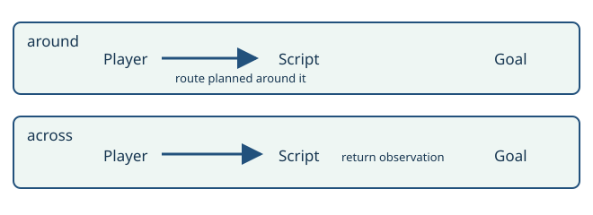

# Let the game run its scripts

> Markdown twin of [trigger-navigation-boundary-v1.html](../trigger-navigation-boundary-v1.html), generated from the HTML by `just explainer-twins`. The HTML is the source; edit it, not this file.

A matching coordinate script is an observation boundary on the route the model selected. Status: unconditional — this behaviour has no switch, so no arm can be scored against a route it is not allowed to walk.

## One policy, two routes

Navigation always prefers a route without matching scripts, even when it is longer. Only when every route crosses one does it walk toward the first matching script on the selected route. Ordinary steps walk without automatic running so they cannot run past a script; existing strides stop before script coordinates. After the trigger step is attempted, navigation sends no more movement or target activation in that call: it returns the resulting state and the model chooses what to do next. It never refuses the route — a refusal would strand the model on a tile with no legal exit.

## What stays authoritative

Collision, elevation, objects, trainer checks, input locks, map transitions and existing loop guards still apply. No story goal, secret destination or script outcome is inferred. A facing-only input also returns control; the result says only that a step was attempted, never that the script ran. A script that already settled still returns control.

## Rustboro evidence

Recorded run ea04, turns 600–660, contained 17 trigger-related refusals. At seq 22793 the player stands at (27,20), while Rustboro state 0x405A equals 1. The source defines triggers at (23,20–24). Their scene changes that state to 2. This explains the original contradiction; it is not a measured performance result.

Game reference: pret/pokeemerald 731ad5bfd6e6f265508d0efcca0ba42f9dcf5881, RustboroCity_EventScript_StolenGoodsTrigger0–4 and StolenGoodsScene.

## Rival house example

Recorded run 1fe0, turn 72, state 1308: player (2,3), matching triggers at (1,3), (2,4), and (3,3). Every route away from the stairs crosses one. A request for the outside door now attempts DOWN to (2,4) and returns the resulting observation; it does not continue to the door. The original run needed nine refused navigation calls before a manual DOWN started the encounter.

Game source: LittlerootTown_MaysHouse_2F_EventScript_SetReadyToMeetMay sets VAR_LITTLEROOT_RIVAL_STATE to 2. LittlerootTown_MaysHouse_1F_EventScript_MeetRival0–2 starts the encounter. No script identity or future story instruction is sent to the gameplay model.

### Two triggers on one route

Player → first trigger → RETURN. A second trigger and the original destination receive no further input in this call. The same rule holds when the step only turns, is blocked, pushes the player back, or the script has already settled. Another attempt requires a new model call.

## Status

Switch: trigger-navigation-boundary-v1. Default OFF. Bundle activation and script-free route preference: a working branch. Control stays OFF. Pending experiment, no queue position or approval. Active run untouched. Gates and independent review are tracked in the worklog; no gameplay benefit is claimed.
