# Turn drought clock (turn-drought-clock-v1)

> Markdown twin of [turn-drought-clock-v1.html](../turn-drought-clock-v1.html), generated from the HTML by `just explainer-twins`. The HTML is the source; edit it, not this file.

Switch `turn-drought-clock-v1`: guard group, needs `stall-briefing-v1`, default OFF, ON in the bundle arm of `bundle-v-control` and `bundle-v-control-2h` (the operator, 2026-10-22: "make it turn based", ON in the bundle).

## The problem

The milestone-drought briefing fired every 5 minutes of play with no new story milestone (`STALL_DROUGHT_MS`). Models act at very different speeds. Across 8 recent 2h runs Qwen made 25-30 actions per 5 minutes and GLM 5-8. So GLM was briefed every 5-8 actions, and the briefing said "What you have been trying is not working" while it was healing and training on purpose. GLM pushed back on it 7-13 times a run.

## 1. Wall clock vs action clock



*Red dots are drought briefings. OFF, both models are briefed at 5 and 10 minutes, so GLM hears it after about 6 actions. ON, every model is briefed after 30 actions without progress: about Qwen's old 5 minutes, and far fewer GLM interruptions.*

## 2. What restarts the clock (ON)

![Green squares restart the count at zero, and the action whose result showed the progress is not counted: the next briefing needs 30 later actions with no progress. All four come from the state the briefing already reads: the milestone events, each party member's level and HP, and the trainer opponent's defeated flag (pokeemerald sets the trainer flag only when the player wins). Only identified POKéMON count: a member with no identity earns no level-up, and a party with any member whose identity or HP the readout cannot read is neither hurt nor healed. A full heal is the same set of members, below full before and all full now: a whiteout that heals the same party counts; a hurt member put in the PC does not. A hold by drought-battle-heal-hold-v1 that kept a due briefing back still restarts the clock when the battle or heal trip ends, as before.](turn-drought-clock-v1/fig-2.svg)

*Green squares restart the count at zero, and the action whose result showed the progress is not counted: the next briefing needs 30 later actions with no progress. All four come from the state the briefing already reads: the milestone events, each party member's level and HP, and the trainer opponent's defeated flag (pokeemerald sets the trainer flag only when the player wins). Only identified POKéMON count: a member with no identity earns no level-up, and a party with any member whose identity or HP the readout cannot read is neither hurt nor healed. A full heal is the same set of members, below full before and all full now: a whiteout that heals the same party counts; a hurt member put in the PC does not. A hold by drought-battle-heal-hold-v1 that kept a due briefing back still restarts the clock when the battle or heal trip ends, as before.*

## 3. What the model reads

| Switch | Briefing headline |
|---|---|
| OFF | `SUPERVISOR: You are stalling. There has been no new story milestone for 5 minutes of play, and the game is not moving forward (stall briefing, N calls into the run). What you have been trying is not working, so do not try it again.` then the bearings list. |
| ON | `SUPERVISOR: No new story milestone, level-up, trainer win or full heal in the last 30 actions (stall briefing, N calls into the run).` |

ON, the rest of the note is facts only:

```
- Last story progress: <the existing line: last milestone, its turn, battles, unfinished activity>
- Where you are: <map and position>
- Story steps the game confirms are done: <list>
```

It never says the plan is failing, never says "stalling" and never asks for a different plan. It carries no next-milestone hint, even with next-milestone-hint-v1 on. The count grows with each briefing: 30, 60, 90 actions.

## 4. How it meets the other drought switches

| Other switch | turn-drought-clock-v1 OFF | turn-drought-clock-v1 ON |
|---|---|---|
| milestone-drought-suppression-v1 ON | Every drought is a diagnostic: "Not sent (milestone-drought-suppression-v1): No new story milestone for 5 minutes of play." | The briefing is sent; no suppression diagnostic. The bundle wants the nudge. |
| drought-battle-heal-hold-v1 ON | Held in battle or on a heal trip; "Not sent (drought-battle-heal-hold-v1): no new story milestone for 5 minutes of play, but …" | Held the same way; "Not sent (drought-battle-heal-hold-v1): no new story milestone, level-up, trainer win or full heal in the last 30 actions, but …" |
| story-character-stall-gate-v1 ON | Held while an untalked story character is near. | Held the same way, at the action level. |
| positive-supervisor-v1 ON | Retired: wall-clock diagnostic only. | Unchanged: still retired on the wall clock. |

## 5. Wiring


*The switch travels in the FeatureSet to the production stall briefing. The outlined box is where behavior changes: the level is `floor(actions / 30)` instead of `floor(play time / 5 min)`. The loop guard records the sent note as a `milestone_drought` loop_guard event, as before; nothing new on the timeline.*

## Status

Unit and production-factory tests cover OFF parity, the 30-action levels, each restart and non-restart, the suppression override and the holds. Not done: multi-model review, landing and measured runs. No benefit is claimed.
