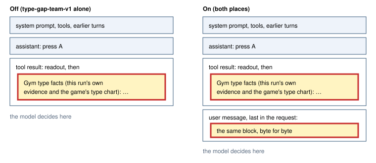

# Gym type gap, last message (type-gap-team-last-message-v1)

> Markdown twin of [type-gap-team-last-message-v1.html](../type-gap-team-last-message-v1.html), generated from the HTML by `just explainer-twins`. The HTML is the source; edit it, not this file.

On in both arms (Operator 2026-10-28, "yes type gap on in both arms"); registered default off. Operator picked "Build the placement switch" on 2026-10-27 after the type-gap decision probes. It needs `type-gap-team-v1`, which is on in both arms. When the GYM TYPE GAP block is added to a tool result and that result is still the newest message, the identical block is also sent as one more user message at the very end of the request. The block on the tool result stays where it is. The copy is never shortened or reworded.

## Where the block sits in the request

Figure 1. The same request with the switch off and on. Yellow boxes hold identical text. On adds only the final message. It also comes after scene-followup-prompt-v1's note when both fire.

## Why: the held-out probes

These are decision probes on four held-out runs, each at the decision right after a loss to a GYM LEADER (runs/probes/type-gap-team-20261027, 16 samples per run). The score is whether the reply plans to find or catch a POKéMON of a type strong against the gym.

| Request | Frozen scorer | Strict scorer |
|---|---|---|
| No block (control) | 13/64 | 21/64 |
| Block on the tool result (type-gap-team-v1) | 40/64 | 41/64 |
| Block in both places (this switch) | 55/64 | 58/64 |

The switch builds the request exactly as the probe's `production_and_last` variant did. A test compares the two message for message.

## Rules

- It fires only when a tool result after the last assistant reply carries the block. In live play the block is its own text part. In a decision probe or after a continuation restore, the result is the recorded text, with its parts joined by line breaks. There the block is the header line plus the lines after it that start with "- " or two spaces, the same bytes byte for byte (checked on every recorded occurrence). Parallel results count, and the newest block wins.
- In live play, an auto-talk message the harness sends for the same result comes after the copy, because it is newer game evidence than the block.
- The copy is transient. The next request has a newer reply, so the copy is gone and only the tool result keeps the block.
- The copy is recorded once per tool result as ledger context, with that result's seq as evidence.
- With type-gap-team-v1 off it does nothing, and the registry rejects that combination.

## Off and on

| Off | On |
|---|---|
| The block is only on the tool result. Requests, tools and recorded events are today's bytes. | The same block is also the final user message of that request. |

## Status

It has unit and production-path tests through `contextTools`. A fresh confirmation probe on GPU1 follows the land.
