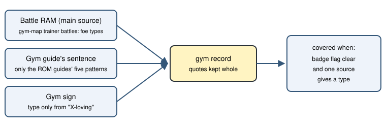
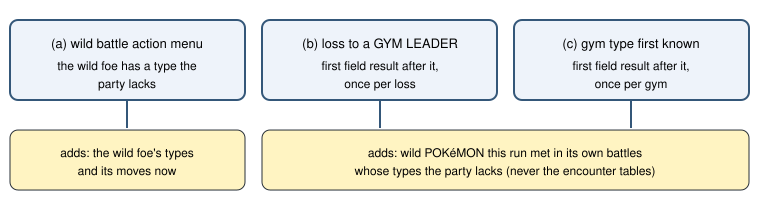

# Gym type gap (type-gap-team-v1)

> Markdown twin of [type-gap-team-v1.html](../type-gap-team-v1.html), generated from the HTML by `just explainer-twins`. The HTML is the source; edit it, not this file.

Bundle arm only, default off. Approved by Operator on 2026-10-27. It puts three things side by side for each gym whose leader is not beaten yet: what this run has seen of the gym's types, the attacking types the game's own type chart makes super effective against them, and which of those the party has. It never advises and never names a place the run has not been.

## Why

In run d41e the gym guide said "ROXANNE, the GYM LEADER, is a user of ROCK-type POKéMON." at turn 309. At turn 334 a lone TORCHIC Lv13 whited out against ROXANNE's GEODUDE. Its next thought was "I need to use a WATER or GRASS type move", and then it planned to grind or rematch. The bag held five POKé BALLs and a GREAT BALL. Nothing set the gym's type next to what the party lacked.

## Where the gym's type comes from



Figure 1. Each gym's record is filled only from this run's own battles and pages. A gym drops out once its badge flag is set.

| Gym guide (ROM text) | Pattern matched |
|---|---|
| RUSTBORO | "is a user of ROCK-type POKéMON." |
| DEWFORD | "commands FIGHTING-type POKéMON." |
| MAUVILLE, LAVARIDGE | "uses ELECTRIC-type / FIRE-type POKéMON." |
| MOSSDEEP | "use PSYCHIC-type POKéMON." |
| FORTREE, SOOTOPOLIS | "is a master of FLYING-type / WATER-type POKéMON." |
| PETALBURG | names no type |

Every sentence was checked against the ROM by `env/tests/env/test_type_gap.py`. Sentences such as "If you challenge him with WATER-type POKéMON" do not match. Only RUSTBORO's sign names a type ("The ROCK-loving honors student!"); the others are printed whole but give no type.

## The game's type chart

The game server reads `gTypeEffectiveness` from the ROM at `0x0831ACE8`: 336 bytes of (attacking type, defending type, multiplier) rows. The multiplier is 0, 5 or 20 tenths, `0xFE` marks the Foresight rows and `0xFF` ends the table. It is read once and cached. The test compares every row with pret/pokeemerald `src/battle_main.c` and finds the table ends right before `gTypeNames` ("NORMAL").

A strong type has a multiplier above ×1. For a POKéMON seen in battle, both of its species types are multiplied, as the game does: against GEODUDE (ROCK/GROUND) WATER is ×4 and ICE is ×2.

## When it shows



Figure 2. Nothing shows in a trainer battle, with no gym type known, when a wild foe's types are all covered, or when a wild foe has one of the gym's own types (a GEODUDE, ROCK/GROUND, after a ROCK gym). Wild POKéMON are listed by species, types and map with their battle count and first and latest turn, for example "MARILL WATER on ROUTE104 (2 battles, turns 895 to 1238)".

## Recorded example: d41e at turn 335

This is the exact block the test `type-gap-team.test.ts` builds from d41e's own pages and states (seq 0 to 12771), with the party's types taken from d41e's battle RAM. d41e also fought gym trainer JOSH, so his GEODUDE is listed. Its wild battles before the loss were ZIGZAGOON, POOCHYENA, RALTS (tutorial) and WURMPLE; none has a gap type, so that line says none.

```
Gym type facts (this run's own evidence and the game's type chart):
- RUSTBORO CITY GYM (ROXANNE not defeated): ROCK — said on RUSTBORO CITY GYM: "ROXANNE, the GYM LEADER, is a user of ROCK-type POKéMON." / "The ROCK type is very durable, but it can't stand WATER-type and GRASS-type moves."; met in battle: JOSH's GEODUDE ROCK/GROUND, ROXANNE's GEODUDE ROCK/GROUND
  Super effective against those, per the game's type chart: WATER, GRASS, ICE, FIGHTING, GROUND, STEEL (against ROCK: WATER ×2, GRASS ×2, FIGHTING ×2, GROUND ×2, STEEL ×2; against GEODUDE ROCK/GROUND: WATER ×4, GRASS ×4, ICE ×2, FIGHTING ×2, GROUND ×2, STEEL ×2)
  No party POKéMON or damaging move has: WATER, GRASS, ICE, FIGHTING, GROUND, STEEL
- Your party (1 of 6): TORCHIC FIRE · damaging moves SCRATCH NORMAL, EMBER FIRE
- Wild POKéMON met this run with those types: none
- Balls in BAG: POKé BALL ×5, GREAT BALL ×1
- Controls: throw a ball with BAG → POKé BALLS pocket → the ball → USE. Outside battle, change party order with START → POKéMON → a POKéMON → SWITCH.
```

Illustrative, from the tests: with a GRASS POKéMON added to the party, the gap line reads "WATER, ICE, FIGHTING, GROUND, STEEL". At a wild WINGULL's action menu the wild line reads "Wild WINGULL is WATER/FLYING (its types in this battle) · moves now: GROWL NORMAL, WATER GUN WATER".

## Off and on

|  | Off | On |
|---|---|---|
| Readout | today's bytes | today's readout, block appended after it on trigger results |
| State JSON | no `type_gap` | `type_gap`: each party slot's species types and its moves' type and power, the type chart rows, a diagnostic |

## Wiring


Figure 3. POKEBENCH_FEATURES_OFF carries the switch to the server; `withTypeGapTeam` in `play-wiring.ts` wraps observe, press, navigate_to, battle_action and choose_evolution.

## Status

Unit tests on d41e, a production-path test through `playGameTools` (red with the wiring removed), and ROM tests for the chart address and guide texts. No review lane, no measured runs, no probe yet.
