# Unfinished activity memory

> Markdown twin of [unfinished-activity-v1.html](../unfinished-activity-v1.html), generated from the HTML by `just explainer-twins`. The HTML is the source; edit it, not this file.

`unfinished-activity-v1` · guidance · bundle arm only · default off · needs `ram-state-v1`

The agent remembers what it started and did not finish, across detours, in the game's own words. It is memory of what the agent did, not a walkthrough: it never says go, fight or return, and it never names a place the agent has not been.

## What happened in r10

Checkpoint run `…gpu0_petalburg2h-r10-whole-map`. The heal detour did resume. The gym was dropped after a second detour, and then the agent could not find its own way back.

*Turns from the recorded events. The battle recap line about ROXANNE was on screen at 323; the plan still changed at 324.*

## What the model sees at turn 323, off and on

OFF (as recorded)

Story goal: "I became a GYM LEADER so that I might apply what I learned at the POKéMON TRAINER'S SCHOOL in battle." (ROXANNE, turn 259) -&gt; "POKéMON TRAINER'S SCHOOL": not resolved: no map in the game's map table has this name. …readout… Battle recap: you lost to ROXANNE (trainer 265) on RUSTBORO CITY GYM (map 11/3) at turn 261 and whited out; …

ON (exact test output)

Story line heard (DAD, turn 20): "Head for RUSTBORO CITY beyond this town." Reached: RUSTBORO CITY (map 0/3), first entered at turn 162. …readout… Unfinished activity (what you did and what the game recorded; it is not an order or a route): - On RUSTBORO CITY GYM (map 11/3): turn 212 you came in; turn 220 you beat JOSH (trainer 320); turn 221 you left with TORCHIC at 7/37 HP; turn 239 your party was healed on RUSTBORO CITY POKEMON CENTER 1F (map 11/5); turn 255 you came back; turn 261 you lost to ROXANNE (trainer 265) and whited out; the game returned you to RUSTBORO CITY (map 0/3). - Still open: ROXANNE (trainer 265) on RUSTBORO CITY GYM (map 11/3): you lost at turn 261. Before that battle, at turn 259, the game showed: "Hello, I am ROXANNE, the RUSTBORO POKéMON GYM LEADER." "I became a GYM LEADER so that I might apply what I learned at the POKéMON TRAINER'S SCHOOL in battle." "Would you kindly demonstrate how you battle, and with which POKéMON?" The game last showed ROXANNE (trainer 265) not defeated (turn 323). - Your own last walk to RUSTBORO CITY GYM (map 11/3), from an exit of this map you can reach on foot now (turns 162-255): ROUTE104 (map 0/19) NORTH edge -&gt; RUSTBORO CITY (map 0/3) door at (27,19) -&gt; RUSTBORO CITY GYM (map 11/3). Battle recap: …

The four things the review asked to keep apart each have their own line: the **heard** instruction, the place **reached**, what was **started** there, and what is **still open**.

## The agent's own walk back

*The ON line at turn 400 (exact test output): "Your own last walk to RUSTBORO CITY GYM (map 11/3), from an exit of this map you can reach on foot now (turns 70-255): ROUTE104 (map 0/19) door at (10,38) -&gt; PETALBURG WOODS (map 24/11) door at (15,5) -&gt; ROUTE104 (map 0/19) NORTH edge -&gt; RUSTBORO CITY (map 0/3) door at (27,19) -&gt; RUSTBORO CITY GYM (map 11/3)."*

## Rules

| Part | Comes from | Rule |
|---|---|---|
| Opens | recorded battle states (`BattleOutcomes`), trainer from `trainer_opponent` | A trainer battle the agent lost or drew. A later loss to the same trainer updates it. Wild battles never open one. |
| Closes | the trainer's defeated flag the game sets | Only when a state shows that trainer defeated, or a later win against it. Detours, story milestones, briefings and context trims never close it. |
| Started | map arrivals, party HP, `activity` heal and blackout events | From the arrival before the first trainer battle on that map: came in, beat or lost to a trainer, left with each party member's HP, heals recorded elsewhere, came back. |
| Still open | delivered field dialogue | The field pages the game showed on that map in the call that started the battle, whole, then the latest reading of the trainer's flag. |
| Own walk | arrivals plus the game's map table | A step is a map-table door within two tiles of where the player last stood, or a map edge. A whiteout or scripted move starts over. Coming back through the exit it left by removes that loop. The walk starts at the latest exit of the current map in it that `exit_reach` lists as reachable on foot; with none, the whole walk is shown. |
| Story line | story-destinations' resolver | A line whose every place is a map entered since it was said reads "Story line heard … Reached: MAP, first entered at turn N" (the first entry since the line, not the latest visit); a line said while the player is already in the map it names reads "you were in it when this was said (since turn N)". Either way it does not drive the walk-away note. A newer line none of whose places resolves does not replace an older one that does. |
| Supervisor notes | `unfinished_activity` events | Loop, stall and text-only notes add "- Unfinished activity (what you did and what the game recorded): " with each open item. |

Nothing is clipped. Each opening, update and retirement is one `unfinished_activity` event in Activity History and the raw-event inspector; there is no timeline mark.

## Wiring

*`playGameTools` puts the block inside `withResultFacts`, so it sits after the low-HP paragraph and before the battle recap. The supervisor reads the recorded events.*

## Status

RED then GREEN on a fixture cut from r10 turns 0–420; full agent suite passes. Pending experiment `experiments/unfinished-activity-v1.json` (activation `RUSTBORO_GYM_TRAINER_JOSH_DEFEATED`, primary `ROXANNE_DEFEATED`), not queued. Bundle arm only. No measured runs yet, so no claim that it helps.
