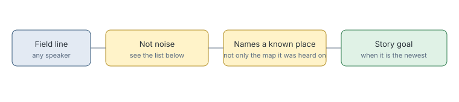

# Unnamed place story line

> Markdown twin of [unnamed-place-story-line-v1.html](../unnamed-place-story-line-v1.html), generated from the HTML by `just explainer-twins`. The HTML is the source; edit it, not this file.

`unnamed-place-story-line-v1` lets anyone the game shows set the Story goal, not only named story characters, when their line names a real place.

## Why it exists

In run ee2a, unnamed Aqua grunts said "Okay! We're to move out to MT. PYRE!" at turn 146. Only story characters could set the Story goal, so the line never reached it.

## How a line qualifies

*A newer place-naming line replaces it, as with any Story goal.*

## Who the line is credited to

| What the game shows | Label |
|---|---|
| The player faced a sprite | `HEX_MANIAC sprite` |
| The game printed a name before the text | `REPORTER` |
| No speaker, sprites on screen | `no speaker shown; on screen: AQUA_MEMBER_M` |
| No speaker, nothing on screen | `no speaker shown` |

The label never guesses a name.

## What is skipped

Signs, battle text, trainer challenges, PokéNav registrations and calls, and the junk filter's service, berry and flavor lines.

## Off

Only story characters set the Story goal.
