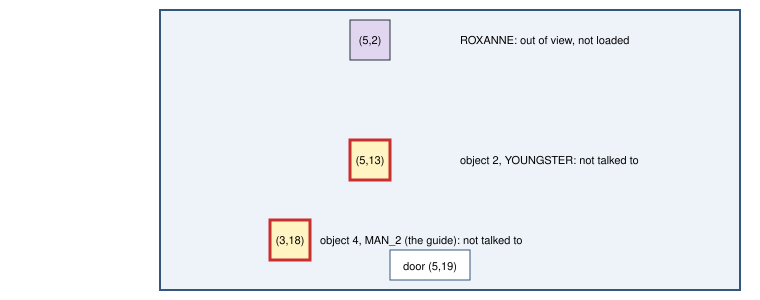

# Untalked people in gym (untalked-in-gym-v1)

> Markdown twin of [untalked-in-gym-v1.html](../untalked-in-gym-v1.html), generated from the HTML by `just explainer-twins`. The HTML is the source; edit it, not this file.

Bundle arm only, default off. Approved by the operator on 2026-10-27. On a gym map, each game-tool result carries, ahead of the readout, the people on the map the player has not talked to this run, with their tiles. Headers that wrap every result, such as harness-trust-v1's, still come first. Run 9e33 never talked to the RUSTBORO gym guide, so it never heard which type the gym uses.

## On the map



Figure 1. d41e's first state inside RUSTBORO CITY GYM (seq 11555). Red boxes are the people the line lists: the objects the game has loaded on the map. Item balls are left out.

## Recorded example: d41e at turn 305

```
People on this gym map you have not talked to this run: object 2, sprite YOUNGSTER, at (5,13); object 4, sprite MAN_2, at (3,18).
```

The line the test builds from d41e's state and the result text the model read with it (seq 11557). After d41e talked to MAN_2 at turn 309, the line would list only the YOUNGSTER. With nobody left it says "none". A story character that character-presence-v1 places on a tile is named, for example "object 1, ROXANNE (sprite ROXANNE), at (5,2)".

## How it differs from untalked-people-header-v1

|  | untalked-people-header-v1 | untalked-in-gym-v1 |
|---|---|---|
| Maps | every map | gym maps only |
| Talked to | since the last story milestone | this run |
| Where | end of harness-trust-v1's header (needs it) | ahead of the readout (after harness-trust-v1's header when that is on); stands alone |
| Record | the same people ledger: an A press or faced-sprite conversation that reached the model, plus the harness's own auto-talks |  |

It never says what anyone will say.

## Off and on

| Off | On |
|---|---|
| No line. Results are today's bytes. | On a gym map's field, observe, press and navigate_to results carry the line ahead of the readout. |

## Status

Unit tests on d41e's gym state and a production-path test through `playGameTools`. No review lane, no measured runs, no probe yet.
