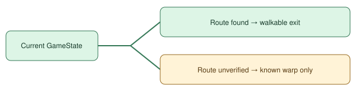

# Verified warp reachability

> Markdown twin of [verified-warp-reach-v1.html](../verified-warp-reach-v1.html), generated from the HTML by `just explainer-twins`. The HTML is the source; edit it, not this file.

## Victory Road B1F

The terrain estimate includes the ladder at (42,25), even from the bridge at (21,11). GameState retains the known ladder and the terrain estimate. Before describing that ladder as walkable, the exit header checks the current warp and route with the navigation planner.

With the switch off, the header uses the original terrain estimate. The navigation tool uses the same movement rules with either setting.
