POKEBENCH · FEATURE EXPLAINER

# Remember only the ground already seen

> Markdown twin of [visited-terrain-navigation-v1.html](../visited-terrain-navigation-v1.html), generated from the HTML by `just explainer-twins`. The HTML is the source; edit it, not this file.

`visited-terrain-navigation-v1` stitches together only cells shown to you this run. It displays that explored terrain and lets `navigate_to` plan across it. It never reads an unseen map cell.

default OFF needs bounded-navigation-v1 64×64 display cap whole map wins if both are ON

## What changes

*Overlap joins observations without filling gaps. An internal state read or hidden press cannot turn a grey cell green.*

## Dynamic facts stay current

| Fact | Memory rule |
|---|---|
| Terrain collision, behavior, elevation | Remembered by map and coordinate after delivery. A later delivered observation replaces the old value. |
| People and moving objects | Never preserved as old positions. The planner uses only objects in the current snapshot, on already known cells. |
| Warps | Remembered when shown; a later observation of that coordinate removes or replaces the old warp fact. |
| Unknown cells | Rendered as `?` and absent from the planner. |

## Exact delivery boundary

*The memory belongs to one `playGameTools` factory instance. There is no file, global cache, emulator RAM field, or synthetic checkpoint sidecar.*

## Checkpoint semantics

An emulator checkpoint restores the game, not this memory.

A run started from Petalburg, the Woods, or any other save state begins with only the first local observation delivered in that new run. It learns additional cells as later results arrive. Reconstructing old observations would be a separate declared sidecar feature; this switch does not do it.

## Compared with whole-map navigation

|  | Visited terrain | Whole map |
|---|---|---|
| Unseen geometry | Hidden | Available immediately |
| Run start | One delivered local window | Entire current map |
| Planner | Up to 512 presses, only across known cells | Up to 512 presses across the map |
| Both selected | Whole-map navigation takes precedence; no duplicate visited map is appended. |  |

## Game grounding and limits

The terrain facts originate in the same live-memory reader as the existing local map. The movement interpretation follows pret/pokeemerald revision `731ad5bfd6e6f265508d0efcca0ba42f9dcf5881`: map collision/elevation in `fieldmap.c`, and object collision/elevation in `event_object_movement.c`. This source explains the fields; it does not supply unseen cells. The display clips explored bounds larger than 64×64 around the player and says so. The underlying known-cell planner memory is not clipped.

## Status

Implemented on a working branch. Unit, factory, OFF-identity, and wiring-deletion tests exist. The switch is default OFF. No measured benefit, review approval, merge, live viewer restart, or experiment launch is claimed.
