Harness switch · walkable-floor-v1

# Sand, caves and mountain tops are floor, not walls

> Markdown twin of [walkable-floor-v1.html](../walkable-floor-v1.html), generated from the HTML by `just explainer-twins`. The HTML is the source; edit it, not this file.

The map text has always drawn these tiles as `.`, but `navigate_to` kept its own short list of walkable tile types: plain ground, grass and doors. Anything else was a wall. On a beach or in a cave the tool could not take a single step. With `walkable-floor-v1` on, it uses the game's own rule: a tile without the collision bit is floor, unless the game does something special when you step on it.

Every one of these is drawn as `.` in the model's map. Before the fix only plain ground was walkable to `navigate_to`.

Tiles opened across the game · **30,647** Dewford Town · **197** Granite Cave 1F · **201** Route 104 · **244** Rusturf Tunnel · **174**

## Route 104 beach

Real live-RAM grid from your human playthrough (event 33236), standing on the beach at (21,68). Target (27,71) on the far side of the cliff. Hatched tiles are ones the old planner refused even though the map drew them as `.`.

### OFF Planner sees walls

0 presses tool gives up

### ON Planner sees floor

9 presses D D D, then R × 6

## Rusturf Tunnel

Same run, event 91964, standing at (10,5) in the tunnel. Target is the south exit warp at (4,10). Every cave tile was refused, so the tool could not take a single step.

### OFF Planner sees walls

0 presses tool gives up

### ON Planner sees floor

11 presses L × 6, then D × 5

## The new rule

This mirrors the game's own check for a step (`GetCollisionAtCoords` and `CheckForObjectEventCollision`). The tile's behavior only matters when the game does something special with it.

Only the highlighted box changed. Before, it was a short allow-list; now it is the game's short list of exceptions.

## What opened up, across every map in the game

Collision-free tiles in every pokeemerald layout that the old planner refused and the new one accepts, by tile behavior.

## What stays refused, and why

| Tiles | Behaviors | Why the planner refuses them |
|---|---|---|
| Surfable water | `0x10–0x15 0x19 0x22 0x2A 0x50–0x53 0x6C 0x6D 0x6F` | Needs Surf. The game marks these `TILE_FLAG_SURFABLE`. |
| Forced movement | `0x20 0x40–0x48 0xBB 0xBC 0xD0 0xD2` | Ice, arrow and slide tiles, muddy slope, cracked floor, jump and spin mats move you on their own, so one press is no longer one tile. |
| Thin and cracked ice | `0x26 0x27` | Sootopolis gym ice cracks, then drops you. |
| Holes and step warps | `0x0D–0x0F 0x29 0x66` | Stepping on them warps or drops you. |
| One-way tiles | `0x30–0x37 0xBE 0xC0 0xC1` | Blocked from some sides only (0xBE is the secret-base breakable door). Still walls here; the chair thread handles them. |
| Ledges | `0x38–0x3F` | Walls when walking; the `ledge-hops-v1` switch hops them in their arrow direction. |
| Acro Bike tiles | `0xD1 0xD3–0xD6` | Bumpy slope and rails refuse a walking player (`CheckAcroBikeCollision`). |

Source: pret/pokeemerald 731ad5b, `src/event_object_movement.c`, `src/field_player_avatar.c`, `src/metatile_behavior.c`. The only tiles that went the other way are 15 water-door tiles (`0x6C 0x6D`), which the old list let you walk into although the game needs Surf.

## Status

- **Tests**: agent 948/948, viewer 493/493, lint clean, coverage above the 90% floor
- **Real-RAM replay**: Your human run: 12,515 targets drawn as `.`; reachable went from 5,206 to 7,508 on the merged branch. 2,302 newly reachable, 0 lost.
- **Switch**: `walkable-floor-v1`. Off: navigate_to keeps the old list (plain ground, grass, doors). Frozen presets that never named it read it as off; new viewer drafts have it on. It only matters when `bounded-navigation-v1` is on.
- **Review**: Round 1 caught the jump/spin mat values (0xBB/0xBC) and undefined bytes ≥ 0xF0. Round 2: Claude and Grok LGTM; Codex caught the breakable door (0xBE). All fixed, and the refused set now matches a script that derives it from the game source.
- **Not done**: Merge to main (needs your OK); no measured runs.
