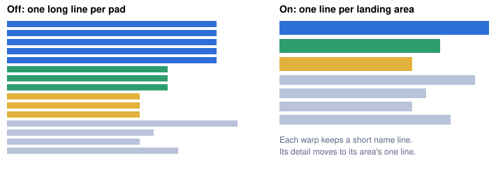

# Warps by landing area

> Markdown twin of [warp-areas-v1.html](../warp-areas-v1.html), generated from the HTML by `just explainer-twins`. The HTML is the source; edit it, not this file.

`warp-areas-v1` regroups the warp facts the readout already prints, so a map with many pads reads as a few areas instead of one long line per pad. It names no route and no best pad. Registered default off, on in both arms of the current recipe.

## Why

On turn 1,533 of DeepSeek run 274b, standing at (0,10) on LAVARIDGE TOWN GYM B1F, 15 `Warp destination` lines took 13,252 of the 38,156 characters the model got. Pads that land in the same place each repeated the same exit list, so nothing said plainly that the 15 pads land in 7 places.

22,342 → 16,462 characters in the server readout for that turn, re-rendered from the run's own RAM archive.

## Before and after



*Same colour means the same landing area. The drawing shows the shape of the change, not exact lengths.*

## What the model reads now

Recorded example, turn 1,533 of run 274b, re-rendered from the run's raw RAM with the visits the run really made up to that turn. The pad groups match the table Operator approved.

```
Warps by landing area (pad → landing tile; facts about each pad, not a route): Temporary objects and scripts may block these terrain paths. Entrance activation uses the map’s default terrain; scripts may change entrances.
- LAVARIDGE TOWN (map 4/1) — southeast terrain section [9,9]. Been there this run: yes. Objects there: MAN_2 at (12,16). Pads you can reach: (8,9) → (8,9). Pads you can't reach: (10,18) → (10,18), (13,17) → (13,17). Terrain exits after arrival: exit (13,18) → LAVARIDGE TOWN (map 0/12); exit (14,18) → LAVARIDGE TOWN (map 0/12); exit (10,18) returns to LAVARIDGE TOWN (map 4/2) — southeast terrain section [14,11] at (10,18) (different terrain section from you); exit (8,9) returns to LAVARIDGE TOWN (map 4/2) — terrain section unknown at (8,9) (unknown terrain section).
- LAVARIDGE TOWN (map 4/1) — southwest terrain section [0,9]. Been there this run: yes. Objects there: MAN_5 at (3,14), MAN_3 at (2,15), MAN_5 at (3,10). Pads you can reach: (0,17) → (0,17), (4,18) → (4,18), (1,14) → (1,14), (0,10) → (0,10), (4,16) → (4,16). Terrain exits after arrival: exit (0,17) returns to LAVARIDGE TOWN (map 4/2) — southwest terrain section [8,10] at (0,17) (different terrain section from you); exit (2,15) returns to LAVARIDGE TOWN (map 4/2) — southwest terrain section [8,10] at (2,15) (different terrain section from you); exit (3,14) returns to LAVARIDGE TOWN (map 4/2) — southwest terrain section [8,10] at (3,14) (different terrain section from you); exit (1,14) returns to LAVARIDGE TOWN (map 4/2) — southwest terrain section [8,10] at (1,14) (different terrain section from you); exit (0,10) returns to LAVARIDGE TOWN (map 4/2) — northwest terrain section [1,6] at (0,10) (same terrain section as you); exit (3,10) returns to LAVARIDGE TOWN (map 4/2) — northwest terrain section [1,6] at (3,10) (same terrain section as you).
- LAVARIDGE TOWN (map 4/1) — southwest terrain section [6,9]. Been there this run: yes. Pads you can reach: (5,14) → (5,14). Terrain exits after arrival: exit (5,14) returns to LAVARIDGE TOWN (map 4/2) — southwest terrain section [8,10] at (5,14) (different terrain section from you); exit (0,17) returns to LAVARIDGE TOWN (map 4/2) — southwest terrain section [8,10] at (0,17) (different terrain section from you); exit (5,9) returns to LAVARIDGE TOWN (map 4/2) — northwest terrain section [5,6] at (5,9) (different terrain section from you); exit (2,15) returns to LAVARIDGE TOWN (map 4/2) — southwest terrain section [8,10] at (2,15) (different terrain section from you); exit (3,14) returns to LAVARIDGE TOWN (map 4/2) — southwest terrain section [8,10] at (3,14) (different terrain section from you); exit (1,14) returns to LAVARIDGE TOWN (map 4/2) — southwest terrain section [8,10] at (1,14) (different terrain section from you); exit (0,10) returns to LAVARIDGE TOWN (map 4/2) — northwest terrain section [1,6] at (0,10) (same terrain section as you); exit (3,10) returns to LAVARIDGE TOWN (map 4/2) — northwest terrain section [1,6] at (3,10) (same terrain section as you).
- LAVARIDGE TOWN (map 4/1) — northwest terrain section [0,2]. Been there this run: yes. Objects there: GIRL_3 at (5,2). Pads you can reach: (0,6) → (0,6), (3,6) → (3,6). Pads you can't reach: (2,3) → (2,3). Terrain exits after arrival: exit (0,6) returns to LAVARIDGE TOWN (map 4/2) — northwest terrain section [1,6] at (0,6) (same terrain section as you); exit (5,6) returns to LAVARIDGE TOWN (map 4/2) — northwest terrain section [5,6] at (5,6) (different terrain section from you); exit (2,3) returns to LAVARIDGE TOWN (map 4/2) — northwest terrain section [0,2] at (2,3) (different terrain section from you); exit (5,2) returns to LAVARIDGE TOWN (map 4/2) — northwest terrain section [0,2] at (5,2) (different terrain section from you).
- LAVARIDGE TOWN (map 4/1) — northeast terrain section [8,2]. Been there this run: yes. Pads you can reach: none. Pads you can't reach: (7,2) → (7,2). Terrain exits after arrival: exit (7,2) returns to LAVARIDGE TOWN (map 4/2) — northwest terrain section [0,2] at (7,2) (different terrain section from you); exit (8,6) returns to LAVARIDGE TOWN (map 4/2) — northwest terrain section [8,6] at (8,6) (different terrain section from you); exit (10,6) returns to LAVARIDGE TOWN (map 4/2) — northeast terrain section [10,6] at (10,6) (different terrain section from you).
- LAVARIDGE TOWN (map 4/1) — northeast terrain section [12,2]. Been there this run: no. Pads you can reach: none. Pads you can't reach: (12,3) → (12,3). Terrain exits after arrival: exit (12,3) returns to LAVARIDGE TOWN (map 4/2) — northwest terrain section [0,2] at (12,3) (different terrain section from you); exit (14,6) returns to LAVARIDGE TOWN (map 4/2) — northeast terrain section [14,6] at (14,6) (different terrain section from you).
- LAVARIDGE TOWN (map 4/1) — southeast terrain section [12,9]. Been there this run: yes. Objects there: FLANNERY at (13,9). Pads you can reach: none. Pads you can't reach: (12,12) → (12,12). Terrain exits after arrival: exit (13,18) → LAVARIDGE TOWN (map 0/12); exit (14,18) → LAVARIDGE TOWN (map 0/12); exit (10,18) returns to LAVARIDGE TOWN (map 4/2) — southeast terrain section [14,11] at (10,18) (different terrain section from you); exit (8,9) returns to LAVARIDGE TOWN (map 4/2) — terrain section unknown at (8,9) (unknown terrain section); exit (12,12) returns to LAVARIDGE TOWN (map 4/2) — southeast terrain section [10,11] at (12,12) (different terrain section from you).
```

The short per-warp lines stay, because the harness's own blocked-exit and no-exit messages read them:

```
Warp destination at (10,18): LAVARIDGE TOWN (map 4/1) — southeast terrain section [9,9]; not reachable on foot from where you stand: no walkable way on this map leads from your tile to it.
Warp destination at (0,17): LAVARIDGE TOWN (map 4/1) — southwest terrain section [0,9].
Warp destination at (8,9): LAVARIDGE TOWN (map 4/1) — southeast terrain section [9,9].
```

<details>
<summary>The same warps with the switch off (three of the 15 lines)</summary>

```
Warp destination at (10,18): LAVARIDGE TOWN (map 4/1) — southeast terrain section [9,9]; not reachable on foot from where you stand: no walkable way on this map leads from your tile to it. Arrives at (10,18). Terrain exits after arrival: exit (13,18) → LAVARIDGE TOWN (map 0/12); exit (14,18) → LAVARIDGE TOWN (map 0/12); exit (10,18) returns to LAVARIDGE TOWN (map 4/2) — southeast terrain section [14,11] at (10,18) (different terrain section from you); exit (8,9) returns to LAVARIDGE TOWN (map 4/2) — terrain section unknown at (8,9) (unknown terrain section). Temporary objects and scripts may block these terrain paths. Entrance activation uses the map’s default terrain; scripts may change entrances.
Warp destination at (0,17): LAVARIDGE TOWN (map 4/1) — southwest terrain section [0,9]. Arrives at (0,17). Terrain exits after arrival: exit (0,17) returns to LAVARIDGE TOWN (map 4/2) — southwest terrain section [8,10] at (0,17) (different terrain section from you); exit (2,15) returns to LAVARIDGE TOWN (map 4/2) — southwest terrain section [8,10] at (2,15) (different terrain section from you); exit (3,14) returns to LAVARIDGE TOWN (map 4/2) — southwest terrain section [8,10] at (3,14) (different terrain section from you); exit (1,14) returns to LAVARIDGE TOWN (map 4/2) — southwest terrain section [8,10] at (1,14) (different terrain section from you); exit (0,10) returns to LAVARIDGE TOWN (map 4/2) — northwest terrain section [1,6] at (0,10) (same terrain section as you); exit (3,10) returns to LAVARIDGE TOWN (map 4/2) — northwest terrain section [1,6] at (3,10) (same terrain section as you). Temporary objects and scripts may block these terrain paths. Entrance activation uses the map’s default terrain; scripts may change entrances.
Warp destination at (8,9): LAVARIDGE TOWN (map 4/1) — southeast terrain section [9,9]. Arrives at (8,9). Terrain exits after arrival: exit (13,18) → LAVARIDGE TOWN (map 0/12); exit (14,18) → LAVARIDGE TOWN (map 0/12); exit (10,18) returns to LAVARIDGE TOWN (map 4/2) — southeast terrain section [14,11] at (10,18) (different terrain section from you); exit (8,9) returns to LAVARIDGE TOWN (map 4/2) — terrain section unknown at (8,9) (unknown terrain section). Temporary objects and scripts may block these terrain paths. Entrance activation uses the map’s default terrain; scripts may change entrances.
```

</details>

## Where each fact comes from

| Fact | Source | Bound |
|---|---|---|
| Landing area | The warp's arrival tile and its terrain section, from `exit-labels-v3` | Pads with the same area and the same exits share a line. A pad whose section is unknown keeps its own line, even when its text matches another. |
| Can or can't reach | The same note the Warp destination line carries, from exit reachability and the Surf gate | Measured from the player's tile at this observation. When neither reach fact was read the line says "reach not measured". |
| Been there this run | Every tile the game server saw the player on this run, tested against the area's section | Starts empty, including from a save state. A re-render from one archive knows only the current tile. Left out when the section is unknown. |
| Objects there | The destination map's object list in ROM, with hide flags and sprite variables read from the save | Only for areas the run has been in. Positions are where the map places them, not where they stand now. An object on a pad counts with the area the pad opens onto. |

## Off and on

Off: each Warp destination line carries its full arrival and terrain-exit detail, byte for byte as recorded (checked against turn 1,533), and there are no area lines. The recorded `exit_sections` JSON is the same either way, so no event schema or viewer reading changes. The tool list and system prompt do not change.

### Wiring

`features.ts` → `POKEBENCH_FEATURES_OFF` → `read_state` hands the run's `AreaVisits` to `read_exit_sections` → `format_readout` prints `warp_area_lines`.

## Status

Operator-directed, with no measured benefit claim. The next DeepSeek run is the first to use it. Merging does not launch anything.
